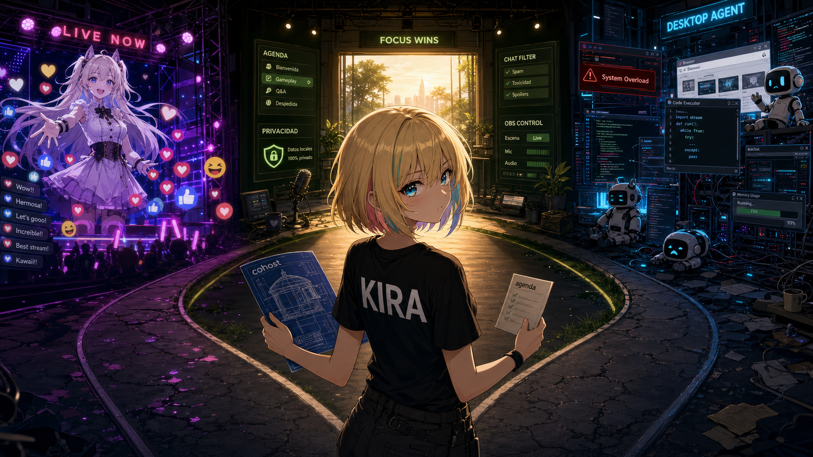
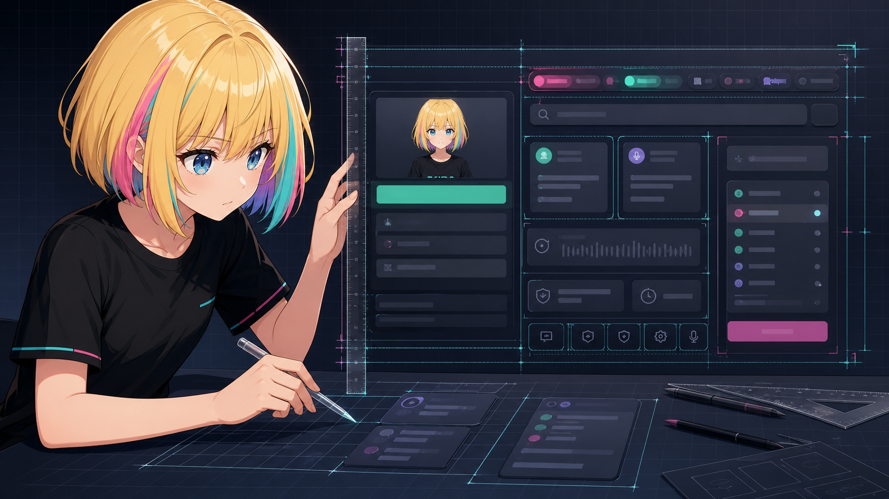
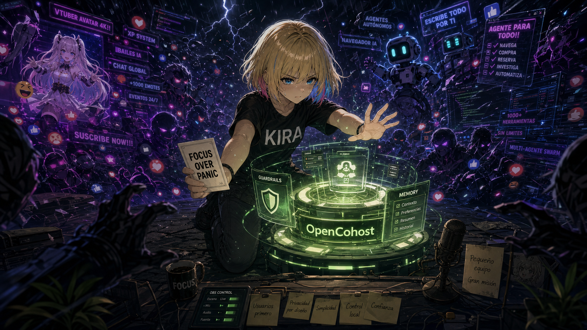

# OpenCohost — Co-host de IA local-first para streaming o como compañera de escritorio


OpenCohost le da a tu stream una co-host que funciona en tu propio equipo. Su personaje es **Kira**, una co-host de IA con personalidad propia (sarcasmo seco, humor afilado) que te escucha, lee tu chat en vivo y responde en voz alta. Kira piensa con un modelo de lenguaje que se ejecuta localmente mediante [Ollama](https://ollama.com/). Habla con Microsoft Edge-TTS, una voz en la nube gratuita, por defecto, o con Piper, una voz que funciona totalmente sin conexión.

[Website](https://opencohost.com) | [Windows App](https://github.com/FranGuh/OpenCohost_UI) | [LiveAudio](https://liveaudio.opencohost.com)

[](LICENSE)
[](https://github.com/plynte-labs/OpenCohost/releases/tag/v0.5.0)
[](pyproject.toml)

> **Novedades de `v0.5.0`:** visión bajo demanda, autoconocimiento, tarjetas activas, compañera de escritorio y más. Mira [las novedades](#novedades-de-v050).

> English version: [README.md](README.md)
> Nota sin AI: [README.note.md](README.note.md)

## Contenido

- [Para streamers y usuarios no técnicos](#para-streamers-y-usuarios-no-técnicos)
  - [Qué hace Kira](#qué-hace-kira)
  - [Empieza en 3 pasos](#empieza-en-3-pasos)
  - [Actualizar desde 0.3.0](#actualizar-desde-030)
  - [Privacidad](#privacidad)
  - [Preguntas frecuentes](#preguntas-frecuentes)
- [Funciones y estado de las versiones](#funciones-y-estado-de-las-versiones)
- [Para usuarios técnicos](#para-usuarios-técnicos)
- [Para desarrolladores](#para-desarrolladores)
- [Comunidad](#comunidad)

---

## Para streamers y usuarios no técnicos



### Qué hace Kira

- **Conversa contigo.** Mantén presionada la tecla de push-to-talk, habla, y Kira responde en voz alta. También puedes escribirle.
- **Sigue tu chat.** Kira lee tu chat de Twitch (YouTube es un complemento opcional y no oficial) y participa cuando el chat está activo, ajustándose al ritmo habitual de tu canal.
- **Recuerda la conversación.** Tiene presentes los últimos intercambios de la sesión, así que sus respuestas siguen el hilo.
- **Cambia de personalidad cuando lo pides.** Elige un perfil como *Calmado*, *Comunidad* o *Show*, o edita el tuyo.
- **Sigue funcionando cuando algo falla.** Si el servicio de voz deja de responder, Kira cambia a una alternativa en lugar de cerrarse.


### Empieza en 3 pasos

Necesitas un PC con Windows. Se recomienda una tarjeta gráfica con 6 GB de memoria de video (VRAM) o más.

1. **Descarga y ejecuta el instalador para Windows.**
   📥 Instalador para Windows: [OpenCohost-0.5.0-x64-setup.exe](https://github.com/plynte-labs/OpenCohost/releases/download/v0.5.0/OpenCohost-0.5.0-x64-setup.exe)
   El instalador es por usuario, así que no necesita derechos de administrador. Muestra la pantalla de bienvenida, luego la **licencia MIT** (acéptala para continuar), luego la carpeta de la aplicación, y después instala. También instala WebView2 si tu PC no lo tiene. En la última pantalla puedes crear un acceso directo en el escritorio y abrir OpenCohost.
   El instalador pesa unos 1,46 GB porque incluye todo lo que Kira necesita para funcionar: el runtime de Python y el motor, el modelo Laya, las voces Piper en español e inglés y el runtime de Microsoft Visual C++. No necesitas instalar Python por tu cuenta. El instalador **no** instala Ollama; ese es el siguiente paso (o usa una clave de API en la nube, ver más abajo).

   > [!NOTE]
   > **Aviso de Windows SmartScreen:** OpenCohost es de código abierto y no tiene un certificado de firma de código de pago, así que Windows Defender SmartScreen puede mostrar la advertencia *"Aplicación no reconocida"* en compilaciones nuevas:
   > 1. Haz clic en **Más información**.
   > 2. Haz clic en **Ejecutar de todas formas**.
   > 3. Para verificar el archivo, compara su hash SHA-256 con `SHA256SUMS.txt` de la misma versión:
   >    ```powershell
   >    Get-FileHash .\OpenCohost-*-x64-setup.exe -Algorithm SHA256
   >    ```

   **En el primer inicio,** OpenCohost te pide una **carpeta de datos**, que debe estar fuera de la carpeta de instalación, y luego un botón **Instalar**. El motor y su runtime de Python vienen dentro del instalador, así que este paso los prepara a partir de los archivos instalados y no necesita descargarlos. Solo recurre a descargar el motor si no se puede usar la copia incluida.

   Después se abre el **asistente de primer uso**, con una decisión por pantalla, y continúa donde lo dejaste si lo cierras:
   - **Primero el idioma.** El idioma que elijas también define el **idioma de Kira**.
   - **Voz.** Elige una voz local de Piper (en español o en inglés, ambas incluidas y totalmente sin conexión) o la voz en la nube de Edge.
   - **Motor.** Usa Ollama local (pasos siguientes) o un proveedor en la nube con tu propia clave de API. Gemini funciona como proveedor en la nube; la prueba de clave comprueba los modelos disponibles y envía una solicitud de chat real.
   - Si el asistente muestra **Reiniciar para aplicar**, púlsalo. Reiniciar el motor termina la conversación actual, la voz en cola y las conexiones en vivo; tu memoria guardada y tus ajustes se conservan.
   - Puedes volver a abrir el asistente más tarde con `/setup`.

2. **Instala Ollama** (omite los pasos 2 y 3 si elegiste una clave de API en la nube en el asistente). Ollama es el programa gratuito que ejecuta el modelo de lenguaje de Kira en tu PC. Descárgalo desde [ollama.com](https://ollama.com/download) y déjalo en ejecución.
3. **Descarga un modelo.** Abre una terminal (PowerShell) y ejecuta:

   ```powershell
   ollama pull llama3
   ```

   `llama3` es el modelo predeterminado de OpenCohost. Otras opciones probadas: `qwen3:4b`, `qwen3:1.7b`, `phi4-mini`, `gemma4:e4b`.

Después abre OpenCohost, elige tu modelo en **Controls → Model** y di algo con push-to-talk o escribe en **Experience**. Kira debería responder con texto y voz.


### Actualizar desde 0.3.0

`0.5.0` es una **actualización selectiva: las memorias empiezan de cero**. El formato de almacenamiento de la memoria cambió, así que las memorias de `0.3.0` y `0.5.0-alpha` **no se importan**. Cuando la carpeta de la instalación anterior contiene tus datos, la app copia (sin sobrescribir) tus perfiles, ajustes, recursos y claves de API a la nueva carpeta de datos, y conserva una copia verificada de los originales en `legacy-preserved`. Los perfiles predeterminados integrados y el progreso de configuración no se arrastran, así que el asistente de primer uso sigue ejecutándose. Si se detecta una instalación anterior, la pantalla de bienvenida lo indica.

1. Ejecuta el instalador nuevo (unos 1,46 GB). Intentará quitar la versión anterior por sí mismo.
2. Si el instalador avisa que no puede, desinstala la versión anterior desde Configuración de Windows -> Aplicaciones y vuelve a ejecutarlo.
3. Opcional: la versión anterior puede dejar una carpeta `resources\runtime` dentro de su carpeta de instalación. Puedes borrarla a mano para recuperar espacio.

### Privacidad

Con la configuración por defecto, el chat, los prompts y el historial de conversación nunca salen de tu equipo — solo las frases que Kira va a decir se envían a Edge-TTS para la síntesis de voz.

| | A dónde va |
|---|---|
| Chat de espectadores, nombres de usuario, memoria conversacional | Nunca salen de tu equipo |
| Inferencia LLM | Ollama local por loopback |
| Texto hablado de Kira | Microsoft Edge-TTS (se evita del todo con el extra `local-tts`) |
| Conexión al chat de Twitch | Conexión anónima y de solo lectura a Twitch; no se sube ningún dato de espectadores |

**Una sola opción cambia esto.** OpenCohost puede ejecutar la inferencia contra un endpoint en la nube compatible con OpenAI en lugar de Ollama. Al activarlo, el prompt completo — persona, memorias guardadas **y el contexto de chat ya filtrado** — se envía a ese proveedor, y aplica su política de retención, no la nuestra. Viene desactivado (`active_provider` es `"local"`), y una configuración de proveedor ausente o corrupta vuelve a modo solo local.

Detalle completo, incluida la salvedad de YouTube: [docs/PRIVACY.md](docs/PRIVACY.md).

### Preguntas frecuentes

**¿Es gratis?**
Sí. OpenCohost es código abierto bajo la Licencia MIT. Ollama y la voz predeterminada Edge-TTS son de uso gratuito. La única opción de pago es un proveedor LLM en la nube, que permanece desactivado salvo que lo actives con tu propia cuenta.

**¿Necesita internet?**
Con la configuración predeterminada, sí: Edge-TTS es una voz en la nube, y leer el chat de Twitch requiere conexión. El modelo de lenguaje se ejecuta en tu PC. Si cambias a la voz Piper sin conexión, Kira habla sin internet.

**¿Qué tarjeta gráfica necesito?**
El modelo lo ejecuta Ollama, así que aplica su compatibilidad de hardware. Como referencia: 6 GB de VRAM para un modelo pequeño, 8–12 GB para un uso cómodo, 16 GB o más para modelos más grandes. Consulta [Hardware](#hardware).

**¿Envía mi chat a alguna parte?**
No con la configuración predeterminada. El chat, los nombres de usuario y la memoria se quedan en tu PC; solo las frases de Kira van a Edge-TTS. Si activas un proveedor LLM en la nube, el contexto de chat filtrado se envía a ese proveedor. Consulta [Privacidad](#privacidad).

**Algo salió mal. ¿Dónde lo reporto?**
Abre un [issue](https://github.com/plynte-labs/OpenCohost/issues). Hay una plantilla para errores y otra para ideas.

---

## Funciones y estado de las versiones

> **Beta abierta.** OpenCohost es un solo desarrollador cubriendo mucha superficie — orquestación LLM, TTS, chat en vivo, OBS, una UI de escritorio — así que algunas cosas todavía no funcionarán bien. Funciona en mi propio equipo todos los días; el núcleo se sostiene. Pero «Estable» en la tabla de abajo significa publicado y sólido en uso normal, no probado ante cada fallo: Windows es la única plataforma validada por completo hasta ahora, y la ruta de streaming e interrupción y el sanitizador de cláusulas aún no han enfrentado un caso adverso en vivo. Si algo se comporta mal, repórtalo — ese feedback es exactamente para lo que existe esta beta. Los errores y las ideas van a [Issues](https://github.com/plynte-labs/opencohost/issues); hay una plantilla para cada caso.

| Función | Estado |
|---|---|
| Chat manual con respuesta por voz | Estable |
| Push-to-talk con tecla global | Estable |
| TTS predeterminado (Edge-TTS, voz en la nube gratuita de Microsoft) | Estable |
| TTS sin conexión opcional (Piper, extra `local-tts`) | Estable |
| Feed de transcripción en vivo por WebSocket | Estable |
| Pipeline TTS por fragmentos (Kira habla antes de que termine el LLM) | Estable |
| Memoria conversacional (ventana deslizante de `HISTORY_MAX_TURNS` turnos — 3 hoy, `opencohost/config/settings.py`) | Estable |
| Perfiles de personalidad (editables desde la UI) | Estable |
| Catálogo de modelos LLM con cambio en un clic | Estable |
| Gestión del ciclo de vida de Ollama desde la UI | Estable |
| Proveedores LLM en la nube opcionales (compatibles con OpenAI) con respaldo local automático | Estable — desactivado por defecto, ver [Privacidad](#privacidad) |
| Agregador de chat inteligente (Twitch) | Estable |
| Activación de chat adaptativa (ajusta el umbral al ritmo real del canal) | Estable |
| Agregador de chat inteligente (YouTube) | Opcional, no oficial — ver [PRIVACY.md](docs/PRIVACY.md#youtube-live-chat-is-opt-in-and-unofficial) |
| Monitor de salud con respaldo de TTS | Estable |
| Modo compacto para streaming en monitor secundario | Estable |

### Versión actual: `v0.5.0`
> **Nota:** Esta es una versión temprana, así que puedes encontrar errores menores o traducciones que no coinciden. Si notas algo inesperado, por favor [abre un
  issue](https://github.com/plynte-labs/OpenCohost/issues).

📥 Instalador para Windows: [OpenCohost-0.5.0-x64-setup.exe](https://github.com/plynte-labs/OpenCohost/releases/download/v0.5.0/OpenCohost-0.5.0-x64-setup.exe)

Los enlaces al instalador de este README funcionan cuando se publique la versión `v0.5.0`. `0.5.0` conserva tus perfiles y ajustes pero empieza las memorias de cero: mira [Actualizar desde 0.3.0](#actualizar-desde-030).

### Novedades de `v0.5.0`
Lista completa de cambios desde `0.3.0-alpha.4`, y por qué esta versión es `0.5.0`: [CHANGELOG.md](CHANGELOG.md) (en inglés).

*Trabajando en ello sin pago, gastando mis ahorros para convertirlo en un mejor producto para ti desde agosto-octubre.*

*Marca el repositorio con una estrella o síguelo para enterarte de las próximas versiones.*

Novedades principales de `v0.5.0`:
- **Visión bajo demanda:** Kira mira tu pantalla solo cuando se lo pides (o con `/mira`): modos pantalla, clip de video y texto, lectura en voz alta, siempre traducido al idioma de la app y con miniaturas de los fotogramas. Usa un modelo de visión local aparte. **Requiere descargar un modelo de visión y lenguaje (VL) (3–7 GB de VRAM).**
- **Autoconocimiento:** respuestas reales sobre la app y el momento (hora, modelo activo, VRAM, creador, comandos, memoria), con un filtro de audiencia para los espectadores e interruptores para desactivarlo.
- **Tarjetas activas:** temas de conversación (patrocinios incluidos) que aparecen solo cuando el tema coincide, mediante coincidencia semántica local, con las frases prohibidas siempre aplicadas.
- **Motor dedicado de VRM y expresiones:** modelo 3D diseñado específicamente para Kira, con sincronización labial y visemas de audio.
- **Modo compañera de escritorio:** interactúa con Kira en una ventana flotante independiente, sincronizada con la línea de tiempo principal.
- **Descargador de modelos integrado:** busca y descarga modelos de Ollama directamente desde la interfaz de la aplicación.
- **Contexto según VRAM y razonamiento adaptativo:** tamaño de contexto automático hasta 16k tokens según la VRAM libre, y presupuestos de razonamiento adaptativos con límites manuales.
- **Recuperación ante bloqueos:** un watchdog libera un modelo colgado, vuelve al último que funcionaba y Kira te lo dice en voz alta.
- **Sistema de perfiles flexible:** prompts de persona limpios y modulares, sin las restricciones fijas heredadas.
- **Memoria v5:** indexación y recuerdo semántico con MiniLM-L12 multilingüe (ONNX) servido por un worker de CPU aislado: sin nube y sin VRAM extra en el runner del LLM.
- **Controles del dueño:** activa o desactiva las reglas de persona y estilo de las respuestas, y edita un diccionario de pronunciación para el TTS.
- **Controles del flujo de voz:** descarta residuos de audio al interrumpir, purga voz obsoleta en regeneraciones rápidas y un modo de lectura en voz alta con pausa.
- **Voces sin conexión incluidas:** el instalador incluye las voces Piper en español e inglés, así que Kira puede hablar sin internet.
- **Asistente de primer uso con elección de voz e idioma:** el idioma que elijas también define el idioma de Kira, y eliges una voz local de Piper o la de Edge.
- **Corrección del proveedor en la nube:** Gemini funciona como proveedor en la nube, y su prueba de clave comprueba los modelos y una solicitud de chat real.
- **Registro de eventos por turno:** un evento estructurado por turno en `logs/turn_events.jsonl`, sin el texto de los mensajes.
- **Comando `/setup`** — configuración del LLM en el primer arranque (proveedor, Ollama, modelos) desde la paleta del chat.

> **Hoja de ruta (no incluido en v1):** La voz local de alta fidelidad mediante Qwen3-TTS / F5 con clonación de voz está planificada como opción avanzada en una versión futura. Requiere un entorno Python separado, ~2 GB de modelos y una GPU con VRAM suficiente.

---

## Para usuarios técnicos

### Requisitos

- **Windows 10 / 11** — la plataforma principal compatible. Linux funciona desde el código fuente ([docs/LINUX_GUIDE.md](docs/LINUX_GUIDE.md)); la validación en máquina limpia para Linux/macOS está en curso.
- **[Ollama](https://ollama.com/) instalado** — Kira no puede responder sin él. Si Ollama está instalado pero no en ejecución, el backend intenta iniciar `ollama serve` en segundo plano al arrancar.
- **Acceso a internet** para la voz predeterminada Edge-TTS, el chat de Twitch y la descarga de modelos.
- **Python 3.10+** solo para ejecutar desde el código fuente (`requires-python = ">=3.10"` en `pyproject.toml`).

### Hardware

| Nivel | VRAM de GPU | Caso de uso |
|---|---|---|
| Mínimo | 6 GB | Edge-TTS (nube); Ollama con un modelo pequeño |
| Recomendado | 8–12 GB | Inferencia LLM cómoda con margen |
| Ideal | 16+ GB | Modelos más grandes sin contención |

### Configuración

**Modelos.** Los modelos se instalan y se eliminan con Ollama (`ollama pull` / `ollama rm`). La tarjeta **Controls → Model** lista lo que Ollama reporta y cambia el modelo activo; nunca descarga uno. El motor verifica Ollama en `http://127.0.0.1:11434/api/tags` y bloquea el procesamiento y el cambio de modelo mientras el servicio no esté disponible.

**Voz (TTS).** Elige el motor en **Controls → Kira's voice**:

| Opción | Notas |
|---|---|
| Edge-TTS (predeterminado) | Voz en la nube gratuita de Microsoft. Solo recibe el texto que Kira va a decir. |
| Piper | Totalmente sin conexión. Viene con el extra `local-tts`; marca **Local TTS only (Piper)** para detener toda llamada a Edge-TTS. |

**Proveedor LLM en la nube (opcional).** Un endpoint compatible con OpenAI puede reemplazar a Ollama para la inferencia. Viene desactivado y vuelve a local cuando su configuración falta o no es válida. Lee [docs/PRIVACY.md](docs/PRIVACY.md) antes de activarlo.

**Rutas de almacenamiento.** Para mover los modelos de Ollama, la caché o los archivos temporales a otra unidad, edita `opencohost/config/storage.yaml`:

```yaml
storage:
  # cache_root: "/ruta/a/tu/cache"
  # temp_root: "/ruta/a/tu/temp"
  # ollama_models: "/ruta/a/tus/modelos/ollama"
```

Dónde se escriben los logs, la configuración y los perfiles depende de cómo se instaló OpenCohost; consulta [Logs and data](docs/QUICKSTART.md#logs-and-data). Define `OPENCOHOST_DEBUG=1` para obtener logs detallados.

**Perfiles de personalidad.** En el primer arranque, OpenCohost genera un conjunto de perfiles de personalidad predeterminados en tu `perfiles.json` local (ignorado por git). Cada perfil incluido está etiquetado por idioma, y el conjunto generado sigue el idioma configurado — `opencohost/config/default_profiles.json` incluye ambos:

| Inglés (`en`) | Español (`es`) | Persona |
|---|---|---|
| Kira | Akira | Co-host por defecto — equilibrada y afilada |
| Kira (Learn) | Akira (Learn) | Modo aprendizaje — educativo y alentador |
| Community | Comunidad | Modo comunidad — cálido e inclusivo |
| Calm | Calmado | Modo calmado — ritmo más lento, tono sereno |
| Technical | Técnico | Modo técnico — preciso, seco, cínico |
| Showtime | Show | Modo de alta energía — enérgico y escénico |

El nombre Kira y la personalidad base se conservan en todos los perfiles.

### Solución de problemas

- [Troubleshooting en la Quick Start](docs/QUICKSTART.md#troubleshooting) — Ollama no detectado, TTS sin sonido, modelos faltantes, conflictos de puertos (en inglés).
- [docs/TROUBLESHOOTING.md](docs/TROUBLESHOOTING.md) — registro de causas raíz de errores conocidos.
- [SUPPORT.md](SUPPORT.md) — dónde pedir ayuda.

---

## Para desarrolladores



### Instalación desde el código fuente

Clona con submódulos: el front end de Tauri es su propio repositorio y está enlazado en `OpenCohost_UI/`. Un `git clone` simple deja ese directorio vacío.

```powershell
git clone --recursive https://github.com/plynte-labs/opencohost.git
cd opencohost

# ¿ya lo clonaste sin submódulos?
git submodule update --init --recursive
```

> Estos comandos asumen que tu entorno Python ya está activado. Reemplaza `python` con la ruta al intérprete de tu entorno si no estás en una shell activada.

```powershell
# Instalar el paquete con la voz predeterminada y las integraciones de plataforma.
# FastAPI y uvicorn (la API HTTP) son dependencias base; no requieren ningún extra.
pip install -e ".[cloud-tts,integrations]"

# Equivalente con uv
uv pip install -e ".[cloud-tts,integrations]"

# Opcional: agregar Piper TTS sin conexión y las herramientas para contribuir
pip install -e ".[cloud-tts,integrations,local-tts,dev]"
```

**Referencia de extras** (`[project.optional-dependencies]` en `pyproject.toml`):

| Extra | Qué habilita |
|---|---|
| `cloud-tts` | Edge-TTS — voz en la nube gratuita de Microsoft (predeterminado) |
| `local-tts` | Piper TTS sin conexión — completamente local, sin llamadas a la nube |
| `integrations` | OBS WebSocket, monitor de VRAM NVIDIA |
| `youtube-chat` | Chat de YouTube no oficial (pytchat) — opcional, [leer esto primero](docs/PRIVACY.md#youtube-live-chat-is-opt-in-and-unofficial) |
| `dev` | pytest, pre-commit, detect-secrets |
| `heavy-tts` | Stack Torch/Transformers del servidor Qwen3-TTS retirado; el producto no lo usa |

#### Requisitos de Tauri

La UI del producto (`pnpm tauri:debug`) necesita un toolchain de Rust/Node además de Python:

| Requisito | Notas |
|---|---|
| [Node.js](https://nodejs.org/) | Cualquier LTS actual |
| [pnpm](https://pnpm.io/) `11.5.2` | Versión fijada vía `packageManager` en `OpenCohost_UI/package.json`; `corepack enable` la detecta automáticamente |
| [Rust + Cargo](https://rustup.rs/) | No hay `rust-toolchain.toml` en este repo — la versión de Rust no está fijada, cualquier toolchain estable reciente funciona |
| [WebView2 Runtime](https://developer.microsoft.com/microsoft-edge/webview2/) | Windows 11 lo incluye por defecto; instalar manualmente en Windows 10 |
| MSVC Build Tools (workload de C++) | Necesario para el target MSVC de `rustc` en Windows — instalar vía [Visual Studio Build Tools](https://visualstudio.microsoft.com/visual-cpp-build-tools/) |

#### Ejecutar

La UI del producto es Tauri, que inicia el backend de Python por su cuenta:

```powershell
cd OpenCohost_UI
pnpm install
pnpm tauri:debug
```

La primera ejecución compila la shell de Rust y tarda más. Ejecútalo desde la shell donde está activado tu entorno Python. Detalle paso a paso: [docs/QUICKSTART.md](docs/QUICKSTART.md).

Para un backend independiente (headless, o con el front end servido aparte), usa `opencohost-api`, `run-api.bat` o `uvicorn` directamente (ver [API HTTP](#api-http)).

### Arquitectura

```
OpenCohost_UI/                # UI del producto — Tauri + React (pnpm tauri:debug), submódulo de git
├── src/features/             # Una carpeta por superficie: agenda, stream, musica, ...
└── src-tauri/src/backend.rs  # Inicia el backend de Python si no hay ninguno escuchando

opencohost/
├── __main__.py           # Muestra un aviso: la GUI legacy está retirada
├── api/                  # Host FastAPI — la superficie del motor del producto
│   ├── engine_host.py    # Composition root: dueño del motor, arma los host flags
│   ├── main.py           # App factory
│   ├── cli.py            # Punto de entrada de consola opencohost-api
│   └── routers/          # Un router por superficie (chat, agenda, ptt, obs, ...)
├── config/
│   ├── logger.py         # Logging estructurado (consola + archivos rotativos)
│   ├── settings.py       # Constantes, catálogo de modelos, system prompt
│   ├── storage.py        # Resolución de rutas portables para cache/temp
│   ├── storage.yaml      # Overrides de rutas de almacenamiento
│   └── default_profiles.json  # Perfiles de personalidad predeterminados
├── core/
│   ├── llm_engine.py     # Orquestación LLM, memoria, pipeline TTS
│   ├── memory/           # Memoria conversacional y de largo plazo
│   ├── speech/           # Pipeline de voz y backends de TTS
│   ├── observability/    # Monitor de salud, estado de servicios, respaldo de TTS
│   ├── profiles/         # Carga/guardado de perfiles de personalidad
│   └── providers/        # Clientes de Ollama local y de nube compatible con OpenAI
├── avatar/               # Control del avatar en OBS
└── smart_aggregator/     # Agregador de chat en vivo (Twitch; YouTube opcional)
```

Lectura más profunda: [docs/architecture.md](docs/architecture.md) y [docs/UI_ARCHITECTURE.md](docs/UI_ARCHITECTURE.md).

### API HTTP

`opencohost/api/` es un proceso FastAPI dueño de su propio motor de Kira. **Es la superficie del motor del producto:** el front end Tauri en `OpenCohost_UI/` maneja a Kira enteramente a través de esta API, y `pnpm tauri:debug` la inicia por ti. Ejecútala por separado solo si quieres un backend headless o si sirves el front end aparte:

```powershell
uvicorn opencohost.api.main:app --host 127.0.0.1 --port 8765 --workers 1
```

**`--workers` DEBE quedar en 1.** Un segundo worker significa un segundo motor — el doble de carga de VRAM/Ollama y una segunda toma del dispositivo de audio. `EngineHost` se niega a iniciar una segunda vez en la misma máquina mediante un lockfile.

**No hagas bind a `--host 0.0.0.0`.** Eso expone la superficie de control del motor a tu LAN. CORS solo restringe a quien llama desde un navegador — no hace nada contra un script o `curl` que llame al puerto directamente. Mantén esto en loopback salvo que pongas un proxy con autenticación delante.

Un router por superficie del producto, bajo `opencohost/api/routers/`: `active_cards`, `agenda`, `agent`, `avatar`, `avatar_vrm`, `chat`, `events`, `guardrails`, `i18n_tts`, `llm_provider`, `memoria`, `model_downloads`, `music`, `obs`, `perfiles`, `personalization`, `ptt`, `self_knowledge`, `speech`, `status`, `stream`, `vision`.

Dos que vale la pena destacar: `GET /api/status` es un snapshot de salud/motor de solo lectura, y `POST /api/perfiles/switch` es idempotente vía el header `Idempotency-Key`. Referencia completa: [docs/api-reference.md](docs/api-reference.md).

### Tests

```powershell
# Recolección completa de tests
python -m pytest --collect-only -q

# Suite focalizada en modelos y recuperación
python -m pytest tests/test_llm_tiers.py tests/test_heavy_model_inference_recovery.py -q

# Suite del monitor de salud
python -m pytest tests/test_health_monitor.py tests/test_health_integration.py -q
```

Ver [docs/TESTING.md](docs/TESTING.md) para la superficie completa de tests.

### Documentación del proyecto

| Documento | Qué cubre |
|---|---|
| [docs/INDEX.md](docs/INDEX.md) | Mapa de todos los documentos de `docs/` |
| [docs/QUICKSTART.md](docs/QUICKSTART.md) | De cero a Kira hablando, desde el código fuente |
| [docs/architecture.md](docs/architecture.md) | Arquitectura del sistema |
| [docs/adr/](docs/adr/) | Registros de decisiones de arquitectura (ADR) |
| [docs/api-reference.md](docs/api-reference.md) | Referencia de la API HTTP |
| [docs/TESTING.md](docs/TESTING.md) | Suite de tests y cómo ejecutarla |
| [docs/TRUST_MODEL.md](docs/TRUST_MODEL.md) | Límites de confianza |
| [docs/PRIVACY.md](docs/PRIVACY.md) | Qué sale de tu equipo |
| [docs/LIVE_SAFETY_CONTROLS.md](docs/LIVE_SAFETY_CONTROLS.md) | Protecciones y filtros de contenido para espectadores |
| [docs/KIRA_COHOST_AGENDA_MODE.md](docs/KIRA_COHOST_AGENDA_MODE.md) | Modo agenda y personalidad |
| [docs/RELEASE.md](docs/RELEASE.md) | Proceso de publicación de versiones |

La mayoría de estos documentos están en inglés.

### Shell legacy de CustomTkinter

La antigua shell de escritorio en CustomTkinter fue retirada y eliminada del repositorio (`opencohost/ui/`; ver [ADR-052](docs/adr/ADR-052-legacy-customtkinter-ui-retirement.md)). `python -m opencohost` ahora solo muestra un aviso que remite a la app de escritorio y a `opencohost-api`. Los ADR y reportes de auditoría más antiguos todavía describen esa shell porque se escribieron cuando era la actual.

---

## Comunidad



- **Contribuir:** lee [CONTRIBUTING.md](CONTRIBUTING.md) antes de abrir un pull request.
- **Código de conducta:** [CODE_OF_CONDUCT.md](CODE_OF_CONDUCT.md).
- **Seguridad:** reporta vulnerabilidades de forma privada como se describe en [SECURITY.md](SECURITY.md), no en issues públicos.
- **Soporte:** [SUPPORT.md](SUPPORT.md).
- **Issues:** usa la plantilla de [reporte de error](.github/ISSUE_TEMPLATE/bug_report.md) o de [solicitud de función](.github/ISSUE_TEMPLATE/feature_request.md) al [abrir un issue](https://github.com/plynte-labs/OpenCohost/issues).

### Licencia

Este proyecto está bajo la Licencia MIT. Ver [LICENSE](LICENSE) para el texto completo.

MIT cubre el código de este repositorio, no sus dependencias. El instalador también incluye componentes de terceros que conservan su propia licencia (por ejemplo Laya con Apache-2.0, mmBERT con MIT, las voces Piper `es_MX-claude-high` con Apache-2.0 y `en_US-kristin-medium` de dominio público, y componentes GPL-3.0 con oferta de código fuente); mira [THIRD-PARTY-NOTICES.md](THIRD-PARTY-NOTICES.md). Dos extras opcionales (`local-tts` e `integrations`) instalan paquetes con licencia GPL, y el launcher instala `local-tts` por defecto. Si vas a redistribuir un build empaquetado — o venderlo — lee antes [THIRD-PARTY-NOTICES.md](THIRD-PARTY-NOTICES.md).
