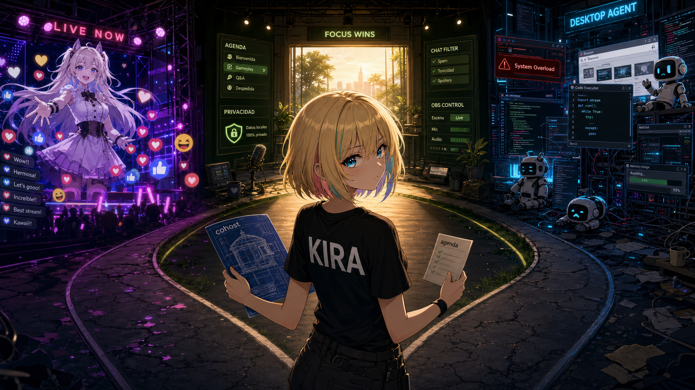
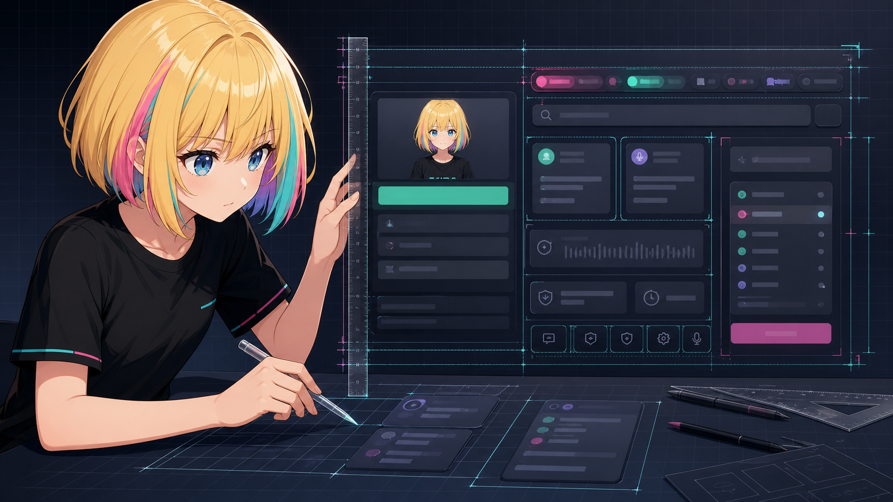
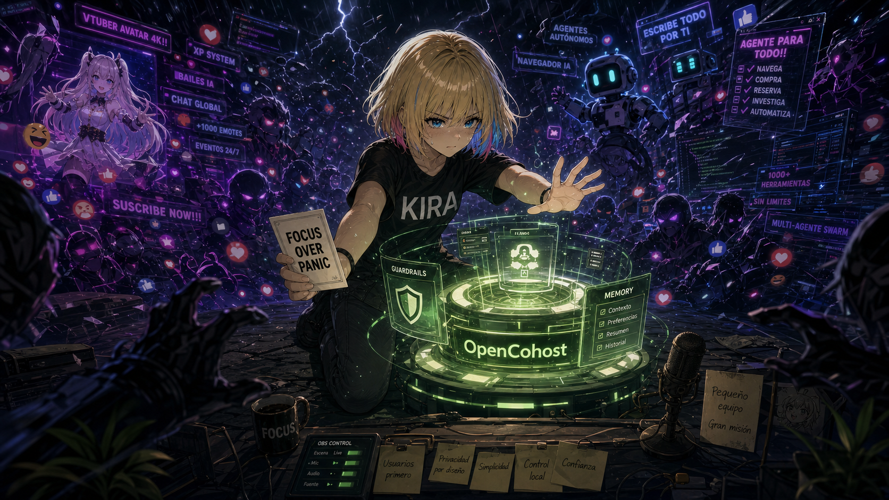

# OpenCohost — Local-First AI Streaming or Companion Co-Host


[Opencohost v0.5.0 maybe came next week (November Q3)]
- [11/12/2026] It's a rought week but i'm seeing a lot of new concepts, and try to polish this fking proyect
- [11/15/2026] Added safety filters, fixed i18n profiles (semantic, locate bugs and filters between en/es in backend and frontend app), new maze v5 to play cards on agenda mode (fixing and mitigate skeletical repetition of content in agenda mode) [you can make mini podcast without reprompting or interacting opencohost, just make the agenda and listen and relax or brb], added support for google gemini api from google ai studio (tested on free usage with gemini 3.5 flash), and fixed more files.

OpenCohost gives your stream a co-host that runs on your own computer. Its character is **Kira**, an AI co-host with a distinct personality (dry sarcasm, sharp humor) who listens to you, reads your live chat and answers out loud. Kira thinks with a language model that runs locally through [Ollama](https://ollama.com/). She speaks with Microsoft Edge-TTS, a free cloud voice, by default, or with Piper, a voice that works fully offline.

[Website](https://opencohost.com) | [Windows App](https://github.com/FranGuh/OpenCohost_UI) | [LiveAudio](https://liveaudio.opencohost.com)

[](LICENSE)
[](https://github.com/plynte-labs/OpenCohost/releases/tag/v0.5.0)
[](pyproject.toml)

> **New in `v0.5.0`:** on-demand vision, self-knowledge, active cards, a desktop companion and more. See [what is new](#whats-new-in-v050).

> Spanish version: [README.es.md](README.es.md)
> Spanish Note without AI: [README.note.md](README.note.md)

## Contents

- [For streamers and non-technical users](#for-streamers-and-non-technical-users)
  - [What Kira does](#what-kira-does)
  - [Get started in 3 steps](#get-started-in-3-steps)
  - [Upgrading from 0.3.0](#upgrading-from-030)
  - [Privacy](#privacy)
  - [FAQ](#faq)
- [Features and release status](#features-and-release-status)
- [For technical users](#for-technical-users)
- [For developers](#for-developers)
- [Community](#community)

---

## For streamers and non-technical users



### What Kira does

- **Talks with you.** Hold the push-to-talk key, speak, and Kira answers out loud. You can also type to her.
- **Follows your chat.** Kira reads your Twitch chat (YouTube is an optional, unofficial add-on) and joins in when the chat is active, adjusting to how busy your channel usually is.
- **Remembers the conversation.** She keeps the last few exchanges of the session in mind, so replies follow the thread.
- **Changes personality on demand.** Pick a profile such as *Calm*, *Community* or *Showtime*, or edit your own.
- **Keeps going when something fails.** If the voice service stops working, Kira switches to a fallback instead of crashing.


### Get started in 3 steps

You need a Windows PC. A graphics card with 6 GB of video memory (VRAM) or more is recommended.

1. **Download and run the Windows installer.**
   📥 Windows installer: [OpenCohost-0.5.0-x64-setup.exe](https://github.com/plynte-labs/OpenCohost/releases/download/v0.5.0/OpenCohost-0.5.0-x64-setup.exe)
   The installer is per-user, so it needs no administrator rights. It shows the Welcome page, then the **MIT license** (accept it to continue), then the application folder, and then it installs. It also installs WebView2 if your PC lacks it. On the last page you can create a desktop shortcut and start OpenCohost.
   The installer is about 1.46 GB because it bundles everything Kira needs to run: the Python runtime and engine, the Laya model, the Spanish and English Piper voices and the Microsoft Visual C++ runtime. You do not need to install Python yourself. The installer does **not** install Ollama; that is the next step (or use a cloud API key instead, see below).

   > [!NOTE]
   > **Windows SmartScreen notice:** OpenCohost is open source and has no paid code-signing certificate, so Windows Defender SmartScreen may show an *"Unrecognized app"* warning on new builds:
   > 1. Click **More info**.
   > 2. Click **Run anyway**.
   > 3. To verify the file yourself, compare its SHA-256 hash with `SHA256SUMS.txt` from the same release:
   >    ```powershell
   >    Get-FileHash .\OpenCohost-*-x64-setup.exe -Algorithm SHA256
   >    ```

   **On first launch,** OpenCohost asks for a **data folder**, which must be outside the install folder, and then an **Install** button. The engine and its Python runtime ship inside the installer, so this step prepares them from the installed files and does not need to download them. It falls back to downloading the engine only if the bundled copy cannot be used.

   Then the **first-run wizard** opens, one decision per screen, and resumes where you left off if you close it:
   - **Language first.** The language you pick also sets **Kira's language**.
   - **Voice.** Choose a local Piper voice (Spanish or English, both included and fully offline) or the Edge cloud voice.
   - **Engine.** Use local Ollama (next steps) or a cloud provider with your own API key. Gemini works as a cloud provider; the key test checks the available models and sends a real chat request.
   - If the wizard shows **Restart to apply**, press it. Restarting the engine ends the current conversation, queued speech and live connections; your saved memory and settings are kept.
   - You can reopen the wizard later with `/setup`.

2. **Install Ollama** (skip steps 2 and 3 if you chose a cloud API key in the wizard). Ollama is the free program that runs Kira's language model on your PC. Download it from [ollama.com](https://ollama.com/download) and leave it running.
3. **Download a model.** Open a terminal (PowerShell) and run:

   ```powershell
   ollama pull llama3
   ```

   `llama3` is OpenCohost's default model. Other tested options: `qwen3:4b`, `qwen3:1.7b`, `phi4-mini`, `gemma4:e4b`.

Then open OpenCohost, choose your model in **Controls → Model**, and say something with push-to-talk or type in **Experience**. Kira should answer with text and voice.


### Upgrading from 0.3.0

`0.5.0` is a **selective upgrade: memories start fresh**. The memory storage format changed, so memories from `0.3.0` and `0.5.0-alpha` are **not imported**. When the previous install folder holds your data, the app copies (never overwrites) your profiles, settings, assets and API keys into the new data folder, and keeps a verified copy of the originals under `legacy-preserved`. Built-in default profiles and setup progress are not carried over, so the first-run wizard still runs. If an old install is detected, the welcome screen says so.

1. Run the new installer (about 1.46 GB). It tries to remove the previous version itself.
2. If the installer says it cannot, uninstall the previous version from Windows Settings -> Apps and run the installer again.
3. Optional: the previous version may leave a `resources\runtime` folder inside its old install folder. You can delete it manually to reclaim space.

### Privacy

With default settings, your chat interactions, prompts, and conversation history never leave your machine — only Kira's outgoing spoken lines are sent to Edge-TTS for audio synthesis.

| | Where it goes |
|---|---|
| Viewer chat, usernames, conversation memory | Never leave your machine |
| LLM inference | Local Ollama over loopback |
| Kira's spoken text | Microsoft Edge-TTS (bypass entirely with the `local-tts` extra) |
| Twitch chat connection | Anonymous, read-only connection to Twitch; no viewer data is uploaded |

**One opt-in changes this.** OpenCohost can run inference against an OpenAI-compatible cloud endpoint instead of Ollama. When you enable it, the full prompt — persona, saved memorias, **and the filtered viewer-chat context** — is sent to that provider, and their retention policy applies, not ours. It is off by default (`active_provider` is `"local"`), and a missing or corrupt provider config resolves back to local-only.

Full detail, including the YouTube opt-in caveat: [docs/PRIVACY.md](docs/PRIVACY.md).

The local usage ledger behind the Activity panel stores counts and labels only, never leaves your PC, and is described in [docs/usage-activity.md](docs/usage-activity.md).

### FAQ

**Is it free?**
Yes. OpenCohost is open source under the MIT License. Ollama and the default Edge-TTS voice are free to use. The only paid option is a cloud LLM provider, which stays off unless you turn it on with your own account.

**Does it need internet?**
For the default setup, yes: Edge-TTS is a cloud voice, and reading Twitch chat needs a connection. The language model itself runs on your PC. If you switch to the offline Piper voice, Kira speaks without internet.

**Which graphics card do I need?**
Ollama runs the model, so its hardware support applies. As a guide: 6 GB of VRAM for a small model, 8–12 GB for comfortable use, 16 GB or more for larger models. See [Hardware](#hardware).

**Does it send my chat anywhere?**
Not with default settings. Chat, usernames and memory stay on your PC; only Kira's own spoken lines go to Edge-TTS. If you turn on a cloud LLM provider, the filtered chat context is sent to that provider. See [Privacy](#privacy).

**Something went wrong. Where do I report it?**
Open an [issue](https://github.com/plynte-labs/OpenCohost/issues). There is a template for bugs and one for ideas.

---

## Features and release status

> **Open beta.** OpenCohost is one developer covering a lot of surface — LLM orchestration, TTS, live chat, OBS, a desktop UI — so some things will not work well yet. It runs on my own hardware every day; the core holds up. But "Stable" in the table below means shipped and solid in normal use, not proven under every failure: Windows is the only fully validated platform so far, and the streaming/interruption path and the clause sanitizer have not yet faced a live adverse case. If something misbehaves, report it — that feedback is exactly what this beta is for. Bugs and ideas both go to [Issues](https://github.com/plynte-labs/opencohost/issues); there is a template for each.

| Feature | Status |
|---|---|
| Manual chat input with voice response | Stable |
| Push-to-talk with global hotkey | Stable |
| Default TTS (Edge-TTS, free Microsoft cloud voice) | Stable |
| Optional offline TTS (Piper, `local-tts` extra) | Stable |
| WebSocket live transcription feed | Stable |
| Streaming TTS pipeline (speaks before LLM finishes) | Stable |
| Conversational memory (sliding window of `HISTORY_MAX_TURNS` turns — 3 today, `opencohost/config/settings.py`) | Stable |
| Personality profiles (editable from UI) | Stable |
| LLM model catalog with one-click switching | Stable |
| Ollama lifecycle management from the UI | Stable |
| Optional cloud LLM providers (OpenAI-compatible) with automatic local fallback | Stable — off by default, see [Privacy](#privacy) |
| Smart Chat Aggregator (Twitch) | Stable |
| Adaptive chat activation (tunes the wake threshold to the channel's own rate) | Stable |
| Smart Chat Aggregator (YouTube) | Opt-in, unofficial — see [PRIVACY.md](docs/PRIVACY.md#youtube-live-chat-is-opt-in-and-unofficial) |
| Health monitor with TTS fallback gate | Stable |
| Compact mode for second-monitor streaming | Stable |

### Current Release: `v0.5.0`
> **Note:** This is an early release, so you may encounter minor bugs or translation mismatches. If you spot anything unexpected, please [open an
  issue](https://github.com/plynte-labs/OpenCohost/issues).

📥 Windows installer: [OpenCohost-0.5.0-x64-setup.exe](https://github.com/plynte-labs/OpenCohost/releases/download/v0.5.0/OpenCohost-0.5.0-x64-setup.exe)

The installer links in this README work once the `v0.5.0` release is published. `0.5.0` keeps your profiles and settings but starts memories fresh: see [Upgrading from 0.3.0](#upgrading-from-030).

### What's new in `v0.5.0`
Full list of changes since `0.3.0-alpha.4`, and why this release is `0.5.0`: [CHANGELOG.md](CHANGELOG.md).

*Working on it without a payment, burning my savings to become a better product 4 you since August-October.*

*Star or follow the repository to track the next releases.*

Key highlights in `v0.5.0`:
- **On-Demand Vision:** Kira looks at your screen only when asked (or via `/mira`) — screen, video-clip and text modes, read-aloud, always translated into the app language, with frame thumbnails. Runs on a separate local vision model. **Needs a vision-language (VL) model download (3–7 GB of VRAM).**
- **Self-Knowledge:** Real answers about the app and the moment (time, active model, VRAM, creator, commands, memory), with an audience filter for viewers and opt-out toggles.
- **Active Cards:** Talking points (sponsors included) that surface only when the topic matches, via local semantic matching, with forbidden phrases always enforced.
- **Dedicated VRM & Expression Engine:** Custom 3D model designed specifically for Kira, featuring synchronized lip-sync and audio visemes.
- **Desktop Companion Mode:** Interact with Kira in an independent, floating companion overlay synchronized with the main timeline.
- **In-App Model Downloader:** Search and pull Ollama models directly from the application interface.
- **VRAM-Aware Context & Adaptive Reasoning:** Automatic context sizing up to 16k tokens based on free VRAM, and adaptive reasoning budgets with manual ceilings.
- **Stall Recovery:** A watchdog frees a hung model, rolls back to the last working one, and Kira tells you out loud.
- **Flexible Profile System:** Clean, modular persona prompts removing legacy hardcoded constraints.
- **Memory v5:** Semantic indexing and recall with multilingual MiniLM-L12 (ONNX) served by an isolated CPU worker — no cloud, no extra VRAM on the LLM runner.
- **Owner Controls:** Toggle persona and style output rules, and an editable pronunciation dictionary for TTS.
- **Speech Flow Controls:** Discard audio residues on interruption, purge stale speech on fast regenerations, and a read-aloud mode with pause.
- **`/setup` command** — first-run LLM configuration (provider, Ollama, models) from the chat palette.
- **Offline voices included:** the installer bundles the Spanish and English Piper voices, so Kira can speak without internet.
- **First-run wizard with voice and language choice:** the language you pick also sets Kira's language, and you choose a local Piper or Edge voice.
- **Cloud provider fix:** Gemini works as a cloud provider, and its key test checks the models and a real chat request.
- **Turn events log:** one structured event per turn in `logs/turn_events.jsonl`, with no message text.
- [15-October-2026] Median time-to-first-speech: ~2.4 s, down from ~20 s two weeks earlier — same model (Qwen3.8-9B Q4, local) on the same RTX 3060 12GB. Full replies finish in ~7 s.
- Liveaudio [liveaudio v1.5.1](https://github.com/plynte-labs/LiveAudio) rewrite in rust now can do faster the STT.
- I introduced Laya(System One) and a little websearch crawler thing.

> **Roadmap (not in v1):** High-fidelity fully-local voice via Qwen3-TTS / F5 voice cloning is planned as an advanced opt-in in a future release. It requires a separate Python environment, ~2 GB of models, and a GPU with sufficient VRAM.

---

## For technical users

### Requirements

- **Windows 10 / 11** — the primary supported platform. Linux runs from source ([docs/LINUX_GUIDE.md](docs/LINUX_GUIDE.md), in Spanish); clean-machine validation on Linux/macOS is in progress.
- **[Ollama](https://ollama.com/) installed** — Kira cannot answer without it. When Ollama is installed but not running, the backend tries to start `ollama serve` in the background at boot.
- **Internet access** for the default Edge-TTS voice, Twitch chat, and pulling models.
- **Python 3.10+** only when running from source (`requires-python = ">=3.10"` in `pyproject.toml`).

### Hardware

| Tier | GPU VRAM | Use case |
|---|---|---|
| Minimum | 6 GB | Edge-TTS (cloud); Ollama on a smaller model |
| Recommended | 8–12 GB | Comfortable LLM inference with headroom |
| Ideal | 16+ GB | Larger models without contention |

### Configuration

**Models.** Models are installed and removed with Ollama itself (`ollama pull` / `ollama rm`). The **Controls → Model** card lists what Ollama reports and switches the active model; it never downloads one. The engine checks Ollama at `http://127.0.0.1:11434/api/tags` and blocks processing and model switching while the service is unavailable.

**Voice (TTS).** Choose the engine in **Controls → Kira's voice**:

| Option | Notes |
|---|---|
| Edge-TTS (default) | Free Microsoft cloud voice. Receives Kira's spoken text only. |
| Piper | Fully offline. Comes with the `local-tts` extra; tick **Local TTS only (Piper)** to stop all Edge-TTS calls. |

**Cloud LLM provider (opt-in).** An OpenAI-compatible endpoint can replace Ollama for inference. It is off by default and falls back to local when its config is missing or invalid. Read [docs/PRIVACY.md](docs/PRIVACY.md) before enabling it.

**Storage paths.** To move Ollama models, cache, or temp files to a different drive, edit `opencohost/config/storage.yaml`:

```yaml
storage:
  # cache_root: "/path/to/your/cache"
  # temp_root: "/path/to/your/temp"
  # ollama_models: "/path/to/ollama/storage"
```

Where logs, config and profiles are written depends on how OpenCohost was installed; see [Logs and data](docs/QUICKSTART.md#logs-and-data). Set `OPENCOHOST_DEBUG=1` for verbose logging.

**Personality profiles.** On first run, OpenCohost seeds a set of default personality profiles into your local `perfiles.json` (ignored by git). Each shipped profile is language-tagged, and the seeded set follows your configured language — `opencohost/config/default_profiles.json` ships both:

| English (`en`) | Spanish (`es`) | Persona |
|---|---|---|
| Kira | Akira | Default co-host — balanced and sharp |
| Kira (Learn) | Akira (Learn) | Learning mode — educational and encouraging |
| Community | Comunidad | Community mode — warm and inclusive |
| Calm | Calmado | Calm mode — slower pace, grounded tone |
| Technical | Técnico | Technical mode — precise, dry, cynical |
| Showtime | Show | High-energy performance mode |

Kira's name and base personality are preserved across all profiles.

### Troubleshooting

- [Troubleshooting in the Quick Start](docs/QUICKSTART.md#troubleshooting) — Ollama not detected, silent TTS, missing models, port conflicts.
- [docs/TROUBLESHOOTING.md](docs/TROUBLESHOOTING.md) — root-cause journal of known bugs (Spanish).
- [SUPPORT.md](SUPPORT.md) — where to ask for help.

---

## For developers



### Setup from source

Clone with submodules — the Tauri front end is its own repository, wired in at `OpenCohost_UI/`. A plain `git clone` leaves that directory empty.

```powershell
git clone --recursive https://github.com/plynte-labs/opencohost.git
cd opencohost

# already cloned without it?
git submodule update --init --recursive
```

> These commands assume your Python environment is already activated. Replace `python` with the path to your environment's interpreter if you are not in an activated shell.

```powershell
# Install the package with the default voice and platform integrations.
# FastAPI and uvicorn (the HTTP API) are core dependencies; no extra is needed for them.
pip install -e ".[cloud-tts,integrations]"

# uv equivalent
uv pip install -e ".[cloud-tts,integrations]"

# Optional: add offline Piper TTS and the contributor tools
pip install -e ".[cloud-tts,integrations,local-tts,dev]"
```

**Extras reference** (`[project.optional-dependencies]` in `pyproject.toml`):

| Extra | What it enables |
|---|---|
| `cloud-tts` | Edge-TTS — Microsoft free cloud voice (default) |
| `local-tts` | Piper offline TTS — fully local, no cloud calls |
| `integrations` | OBS WebSocket, NVIDIA VRAM monitor |
| `youtube-chat` | Unofficial YouTube live chat (pytchat) — opt-in, [read this first](docs/PRIVACY.md#youtube-live-chat-is-opt-in-and-unofficial) |
| `dev` | pytest, pre-commit, detect-secrets |
| `heavy-tts` | Torch/Transformers stack for the retired Qwen3-TTS server; not used by the product |

#### Tauri prerequisites

The product UI (`pnpm tauri:debug`) needs a Rust/Node toolchain on top of Python:

| Requirement | Notes |
|---|---|
| [Node.js](https://nodejs.org/) | Any current LTS |
| [pnpm](https://pnpm.io/) `11.5.2` | Version pinned via `packageManager` in `OpenCohost_UI/package.json`; `corepack enable` picks it up automatically |
| [Rust + Cargo](https://rustup.rs/) | No `rust-toolchain.toml` in this repo — the Rust version is unpinned, any recent stable toolchain works |
| [WebView2 Runtime](https://developer.microsoft.com/microsoft-edge/webview2/) | Windows 11 ships it by default; install manually on Windows 10 |
| MSVC Build Tools (C++ workload) | Required for the `rustc` MSVC target on Windows — install via [Visual Studio Build Tools](https://visualstudio.microsoft.com/visual-cpp-build-tools/) |

#### Run

The product UI is Tauri, which spawns the Python backend on its own:

```powershell
cd OpenCohost_UI
pnpm install
pnpm tauri:debug
```

The first run compiles the Rust shell and takes longer. Run it from the shell where your Python environment is activated. Step-by-step detail: [docs/QUICKSTART.md](docs/QUICKSTART.md).

For a standalone backend (headless, or with the front end served separately), use `opencohost-api`, `run-api.bat`, or `uvicorn` directly (see [HTTP API](#http-api)).

### Architecture

```
OpenCohost_UI/                # Product UI — Tauri + React (pnpm tauri:debug), git submodule
├── src/features/             # One folder per surface: agenda, stream, musica, ...
└── src-tauri/src/backend.rs  # Spawns the Python backend if none is listening

opencohost/
├── __main__.py           # Prints a notice: the legacy GUI is retired
├── api/                  # FastAPI host — the product's engine surface
│   ├── engine_host.py    # Composition root: owns the motor, arms host flags
│   ├── main.py           # App factory
│   ├── cli.py            # opencohost-api console entry point
│   └── routers/          # One router per surface (chat, agenda, ptt, obs, ...)
├── config/
│   ├── logger.py         # Structured logging (console + rotating files)
│   ├── settings.py       # Constants, model catalog, system prompt
│   ├── storage.py        # Portable path resolution for cache/temp
│   ├── storage.yaml      # Storage path overrides
│   └── default_profiles.json  # Seeded personality profiles
├── core/
│   ├── llm_engine.py     # LLM orchestration, memory, TTS pipeline
│   ├── memory/           # Conversation and long-term memory
│   ├── speech/           # Speech pipeline and TTS backends
│   ├── observability/    # Health monitor, service state, TTS fallback gate
│   ├── profiles/         # Personality profile load/save
│   └── providers/        # Local Ollama and OpenAI-compatible cloud clients
├── avatar/               # OBS avatar control
└── smart_aggregator/     # Live chat aggregator (Twitch; YouTube opt-in)
```

Deeper reading: [docs/architecture.md](docs/architecture.md) and [docs/UI_ARCHITECTURE.md](docs/UI_ARCHITECTURE.md).

### HTTP API

`opencohost/api/` is a FastAPI process that owns its own Kira engine. **It is the product's engine surface:** the Tauri front end in `OpenCohost_UI/` drives Kira entirely through it, and `pnpm tauri:debug` starts it for you. Run it standalone only if you want a headless backend or are serving the front end separately:

```powershell
uvicorn opencohost.api.main:app --host 127.0.0.1 --port 8765 --workers 1
```

**`--workers` MUST stay at 1.** A second worker means a second engine — double VRAM/Ollama load and a second audio device grab. `EngineHost` refuses to start a second time on the same machine via a lockfile.

**Do not bind `--host 0.0.0.0`.** That exposes the engine control surface to your LAN. CORS only restricts browser callers — it does nothing against a script or `curl` hitting the port directly. Keep this on loopback unless you put an authenticating proxy in front of it.

One router per product surface, under `opencohost/api/routers/`: `active_cards`, `agenda`, `agent`, `avatar`, `avatar_vrm`, `chat`, `events`, `guardrails`, `i18n_tts`, `llm_provider`, `memoria`, `model_downloads`, `music`, `obs`, `perfiles`, `personalization`, `ptt`, `self_knowledge`, `speech`, `status`, `stream`, `vision`.

Two worth calling out: `GET /api/status` is a read-only health/engine snapshot, and `POST /api/perfiles/switch` is idempotent via the `Idempotency-Key` header. Full reference: [docs/api-reference.md](docs/api-reference.md).

### Testing

```powershell
# Full test collection
python -m pytest --collect-only -q

# Focused model + recovery suite
python -m pytest tests/test_llm_tiers.py tests/test_heavy_model_inference_recovery.py -q

# Health monitor suite
python -m pytest tests/test_health_monitor.py tests/test_health_integration.py -q
```

See [docs/TESTING.md](docs/TESTING.md) for the full test surface.

### Project docs

| Document | What it covers |
|---|---|
| [docs/INDEX.md](docs/INDEX.md) | Map of every document in `docs/` |
| [docs/QUICKSTART.md](docs/QUICKSTART.md) | From zero to Kira speaking, from source |
| [docs/architecture.md](docs/architecture.md) | System architecture |
| [docs/adr/](docs/adr/) | Architectural Decision Records |
| [docs/api-reference.md](docs/api-reference.md) | HTTP API reference |
| [docs/TESTING.md](docs/TESTING.md) | Test suite and how to run it |
| [docs/TRUST_MODEL.md](docs/TRUST_MODEL.md) | Trust boundaries |
| [docs/PRIVACY.md](docs/PRIVACY.md) | What leaves your machine |
| [docs/LIVE_SAFETY_CONTROLS.md](docs/LIVE_SAFETY_CONTROLS.md) | Viewer guardrails and content filters |
| [docs/KIRA_COHOST_AGENDA_MODE.md](docs/KIRA_COHOST_AGENDA_MODE.md) | Agenda mode and personality |
| [docs/RELEASE.md](docs/RELEASE.md) | Release process |

### Legacy CustomTkinter shell

The old CustomTkinter desktop shell has been retired and removed from the repository (`opencohost/ui/`; see [ADR-052](docs/adr/ADR-052-legacy-customtkinter-ui-retirement.md)). `python -m opencohost` now only prints a notice that points to the desktop app and to `opencohost-api`. Older ADRs and audit reports still describe that shell because they were written while it was current.

---

## Community



- **Contributing:** read [CONTRIBUTING.md](CONTRIBUTING.md) before opening a pull request.
- **Code of Conduct:** [CODE_OF_CONDUCT.md](CODE_OF_CONDUCT.md).
- **Security:** report vulnerabilities privately as described in [SECURITY.md](SECURITY.md), not in public issues.
- **Support:** [SUPPORT.md](SUPPORT.md).
- **Issues:** use the [bug report](.github/ISSUE_TEMPLATE/bug_report.md) or [feature request](.github/ISSUE_TEMPLATE/feature_request.md) template when you [open an issue](https://github.com/plynte-labs/OpenCohost/issues).

### License

This project is licensed under the MIT License. See [LICENSE](LICENSE) for the full text.

MIT covers this repository's code, not its dependencies. The installer also bundles third-party components that keep their own licences (for example Laya under Apache-2.0, mmBERT under MIT, the Piper voices `es_MX-claude-high` under Apache-2.0 and `en_US-kristin-medium` in the public domain, and GPL-3.0 components with a source offer); see [THIRD-PARTY-NOTICES.md](THIRD-PARTY-NOTICES.md). Two optional extras (`local-tts` and `integrations`) pull in GPL-licensed packages at install time, and `local-tts` is installed by default by the launcher. If you plan to redistribute a bundled build — or sell one — read [THIRD-PARTY-NOTICES.md](THIRD-PARTY-NOTICES.md) first.
