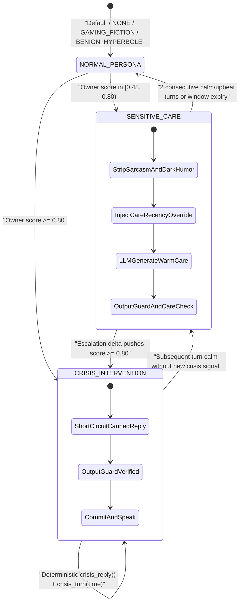

# Contextual Crisis Safety & Persona Precedence Architecture

**Status:** Design & Executable Specification (Pre-Implementation Blueprint)  
**Target Scope:** `opencohost/core/safety/`, `opencohost/core/context/`, `opencohost/core/llm_engine.py`, `opencohost/smart_aggregator/`, `opencohost/config/validation.py`  
**Reference Specification Suite:** [`tests/test_safety_contextual_design_spec.py`](../tests/test_safety_contextual_design_spec.py)

---

## 1. Executive Summary & Non-Negotiable Invariants

OpenCohost's S1–S7 vulnerable-user guardrails (2026-11-14) established critical foundations: normalized bilingual crisis regexes (`detect_crisis`), per-turn `ContextVar` exemptions (`crisis_turn`), viewer crisis chat dropping (`Aggregator.process_message`), honest AI disclosure (`_has_honest_disclosure`), locked isolation boundaries (`no_isolation_pressure`), log redaction (`redact_block_preview`), and screen/input normalization (`normalize_for_screen`).

However, live streaming introduces five structural tensions that a stateless boolean regex + post-hoc `output_guard` cannot resolve alone:

1. **Gaming & Fiction Mortality vs. First-Person Crisis:** Streamers constantly talk about death, bosses suiciding, resetting runs, and horror lore (Elden Ring, Phasmophobia, Cyberpunk, Dead by Daylight, Doki Doki Literature Club).
2. **Gamer Sarcasm & Hyperbole:** Idioms like `"matenme pls qué cringe"`, `"kill me now lol"`, and `"me muero de risa"` must not trigger a crisis turn—yet laughter must never mask an explicit self-harm statement. Owner decision 2026-11-16 (option B): `"me quiero morir jaja"`, `"i want to kill myself lol"`, and `"quiero matarme xd"` are explicit first-person self-harm and stay `CRISIS_INTERVENTION` (see H8).
3. **Persona Sarcasm vs. Crisis Rule Contradiction:** Kira's persona explicitly requests sarcasm, sharp wit, and subtle dark humor, while `core_rules.body` demands dropping sarcasm in a crisis. Today, `MotorVocalIA._generar_dialogo` still sends the full sarcastic persona prompt to a 9B local model on a `crisis_turn`, and `output_guard` has no sarcasm check.
4. **Multi-Turn Trajectory vs. Privacy Policy:** Single-message matching misses gradual 2–3 turn distress escalation, while any multi-turn tracking in `SmartAggregator` MUST strictly obey the SmartAggregator Input Policy: **never expose raw viewer chat in prompts, logs, or persistence**.
5. **Agenda Move Deck & 9B Nihilistic Drift:** Existential/dark agenda topics (e.g., *"Teoría del internet muerto"*, *"Si el universo nos controla"*) paired with `extreme_case` or `inversion` deck cards can push a 9B model into nihilistic or self-harm phrasing that trips `output_guard` or degrades session safety.

### Hard Invariants (Must Never Be Violated)

| # | Invariant | Enforcement Anchor |
|---|---|---|
| **H1** | `llm.crisis_reply` text in `opencohost/locales/{es,en}/manifest.yaml` is owner-approved and **immutable** without explicit owner approval. | `tests/test_crisis_reply.py` |
| **H2** | Existing `output_guard` locked rules (`no_hate_speech`, `no_human_claim`, `no_isolation_pressure`, `no_code_output`, `no_memory_denial`, `no_false_capability`, `never_invent_confirmations`) are **never weakened**. | `opencohost/config/validation.py` |
| **H3** | Only owner sources (`direct`, `ptt`, `owner-bundle`) may enter `CRISIS_INTERVENTION` or `SENSITIVE_CARE` reply states. Viewer `chat` and `kira-agenda*` never trigger Kira's crisis-turn generation. | `opencohost/core/llm_engine.py` (`_CRISIS_SOURCES`) |
| **H4** | Viewer crisis messages in `SmartAggregator` are withheld before reaching `IntentAggregator`, `VibeThermometer`, `ChatReactionCore`, `highlight_scoring`, prompts, logs, or SQLite/JSONL persistence. | `opencohost/smart_aggregator/aggregator.py` |
| **H5** | Multi-turn state stores **metadata only** (timestamps, numeric scores, boolean flags, ephemeral HMAC-SHA256 viewer tokens)—never raw text, snippets, or plaintext usernames. | `SmartAggregator Input Policy` |
| **H6** | Agenda Deck safety filtering MUST remain a pure function of `(topic_id, turn_index, topic_safety_tier, deck)` so `prefetch_action_after_current_speech()` and `next_action()` always pick the exact same move. | `opencohost/smart_aggregator/kira_agenda_controller.py` |
| **H7** | Normal, gaming, and benign-hyperbole owner turns produce **byte-identical prompts** to current behavior. | `opencohost/core/context/prompt_assembler.py` |
| **H8** | Owner decision 2026-11-16 (option B): laughter or joke markers (`jaja`, `jsjs`, `xd`, `lol`, `haha`, `lmao`, `😂`, `🤣`, `💀`, `just kidding`, `jk`, ...) **never** lower an explicit first-person self-harm or suicide statement (any `crisis.py` stem, `TIER_A_EXPLICIT`: `"me quiero morir"`, `"matarme"`, `"suicidarme"`, `"kill myself"`, `"want to die"`, ...) below `CRISIS_INTERVENTION`, wherever the marker sits and for owner and chat turns alike. Only an explicit in-game mechanic locator (`para resetear`, `checkpoint`, `en el juego`, `after that miss`, ...) may dampen such a stem. Idioms without explicit self-harm intent (`"me muero de risa"`, `"this boss killed me"`, `"I'm dead lol"`, `"kill me now lol"`) remain non-crisis. | `ContextualCrisisArbiter.assess` (`opencohost/core/safety/contextual.py`); `TestLaughterNeverDowngradesExplicitSelfHarm` in `tests/test_safety_adversarial_redteam.py` |

---

## 2. Current Baseline & Observed Codebase Gaps

Inspection of the current codebase reveals the exact seam behavior and gaps:

| Component | Current Implementation (Observed) | Gap / Tension |
|---|---|---|
| [`opencohost/core/safety/crisis.py`](../opencohost/core/safety/crisis.py) | `detect_crisis(text) -> bool` normalizes text (`NFKC`, fold accents, collapse 3+ repeats) and matches 25 `_ES` + 17 `_EN` regexes. Excludes only immediate suffixes in `_HYPERBOLE_ES` (`de risa`, `de verguenza`, ...) and `_HYPERBOLE_EN` (`laughing`, `of cringe`, ...). | **FP:** `"quiero suicidarme en el juego para resetear el boss"` returns `True`. (`"me quiero morir jaja"`, `"me quiero matar lol"`, `"i wanna die lol"` also return `True`; per H8 that is correct, not a false positive.)<br>**FN:** Multi-turn escalation (`"estoy agotado"` → `"nada tiene sentido"` → `"ya no aguanto"`) returns `False` on every turn. |
| [`opencohost/core/llm_engine.py`](../opencohost/core/llm_engine.py#L2181-L2197) | `_generar_dialogo` sets `crisis = source in _CRISIS_SOURCES and detect_crisis(contexto)` and enters `with crisis_turn(crisis):` before calling `_generar_dialogo_core`. | Still runs full LLM generation with active sarcastic `system_prompt`. `crisis_reply()` only fires if `output_guard` blocks (and retry fails) or LLM returns empty (`_guardrail_fallback_line`). A 9B model can emit a sarcastic response that passes `output_guard`. |
| [`opencohost/config/validation.py`](../opencohost/config/validation.py#L960-L1227) | When `is_crisis_turn()` is `True`, `output_guard` exempts `no_ai_self_identification`, `no_machine_lecture`, `never_promise`, `no_suspicious_links`, and `no_doxxing`, keeping `no_hate_speech`, `no_human_claim`, `no_isolation_pressure`, etc. locked. | Has no sarcasm/mockery check on `SENSITIVE_CARE` turns and no `no_nihilistic_self_harm_drift` check for 9B agenda generation. |
| [`opencohost/smart_aggregator/aggregator.py`](../opencohost/smart_aggregator/aggregator.py#L570-L583) | `if accepted and detect_crisis(str(filtered.get("text", ""))):` drops the message and increments `self.crisis_screened_count`. | Drops in-game mechanic phrasing (`"me voy a matar en el boss para resetear"`) as crisis; has no per-viewer ephemeral trajectory for escalating distress. |
| [`opencohost/locales/es/manifest.yaml`](../opencohost/locales/es/manifest.yaml#L33-L58) | `llm.system_prompt` mandates `"Sarcástica con ingenio afilado"`, `"humor negro sutil"`, `"tu default es sarcasmo"`. `core_rules.body` only applies to custom profiles (`persona_custom=True`), and even then sits alongside the custom persona's sarcasm directives. | Conflicting instructions on small local models (9B); sarcasm overrides care when both sit in the same system prompt. |
| [`opencohost/smart_aggregator/kira_agenda_controller.py`](../opencohost/smart_aggregator/kira_agenda_controller.py#L90-L97) | `pick_progression_move(topic_id, turn_index, moves)` draws uniformly from `progression.moves` (e.g., `extreme_case`, `inversion`) regardless of topic sensitivity. | Existential/dark topics + `extreme_case` card on a 9B model can induce fatalistic or self-harm-adjacent nihilism. |

---

## 3. Core Data Structures

All safety evaluation types are pure, immutable (frozen dataclasses / enums), dependency-free, and carry **no raw user text** in telemetry or trajectory records.

```python
from __future__ import annotations

from dataclasses import dataclass, field
from enum import Enum
from typing import Literal


class SafetySeverity(str, Enum):
    NONE = "none"
    BENIGN_HYPERBOLE = "benign_hyperbole"
    GAMING_FICTION = "gaming_fiction"
    SENSITIVE_CARE = "sensitive_care"
    CRISIS_INTERVENTION = "crisis_intervention"


class TurnSource(str, Enum):
    DIRECT = "direct"
    PTT = "ptt"
    OWNER_BUNDLE = "owner-bundle"
    CHAT = "chat"
    KIRA_AGENDA = "kira-agenda"
    KIRA_AGENDA_STOP = "kira-agenda-stop"


OWNER_CRISIS_SOURCES = frozenset({
    TurnSource.DIRECT.value,
    TurnSource.PTT.value,
    TurnSource.OWNER_BUNDLE.value,
})


@dataclass(frozen=True)
class StreamContextMetadata:
    """Read-only stream metadata used as weak contextual priors (never overrides explicit plan)."""
    active_game: str = ""
    game_genres: tuple[str, ...] = ()
    active_topic_title: str = ""
    active_card_tags: tuple[str, ...] = ()
    chat_activity_mood: Literal["upbeat", "meme", "neutral", "tense"] = "neutral"


@dataclass(frozen=True)
class SignalBreakdown:
    """Auditable, text-free breakdown of contextual crisis scoring."""
    lexical_tier: Literal[
        "none",
        "third_person_fiction",
        "colloquial_hyperbole",
        "weak_hopeless",
        "moderate_distress",
        "strong_suicidal",
        "explicit_plan_or_farewell",
    ]
    base_score: float
    laughter_dampener: float
    gaming_dampener: float
    serious_amplifier: float
    trajectory_delta: float
    final_score: float
    dampeners_vetoed: bool
    dampeners_applied: tuple[str, ...] = ()
    amplifiers_applied: tuple[str, ...] = ()


@dataclass(frozen=True)
class CrisisAssessment:
    """Actionable verdict emitted by the ContextualCrisisArbiter."""
    severity: SafetySeverity
    should_trigger_crisis_turn: bool
    should_strip_sarcasm: bool
    should_withhold_chat_msg: bool
    bypass_llm_with_canned_reply: bool
    signals: SignalBreakdown


@dataclass(frozen=True)
class SafetyTurnRecord:
    """Privacy-safe trajectory item: NEVER stores text, usernames, or text hashes."""
    timestamp_monotonic: float
    severity: SafetySeverity
    effective_score: float
    had_distress_signal: bool
    had_dampener_only: bool


class TopicSafetyTier(str, Enum):
    STANDARD = "standard"
    EXISTENTIAL_DARK = "existential_dark"
    VULNERABLE_PERSONAL = "vulnerable_personal"


@dataclass(frozen=True)
class TopicSafetyProfile:
    tier: TopicSafetyTier
    blocked_families: frozenset[str] = frozenset()
    framing_anchor_key: str = ""
```

---

## 4. Multi-Signal Scoring & Arbiter Model (Q1 & Q2)

### 4.1 Signal Layers

Rather than a binary `detect_crisis(text) -> bool`, evaluation runs as a deterministic four-stage pipeline over `normalize(text)` (reusing `crisis._normalize` semantics: NFKC, zero-width strip, lowercase, NFD accent fold, apostrophe strip, 3+ repeat collapse):

1. **Grammatical & Lexical Tiering (`_classify_lexical_tier`)**:
   - **Third-Person / Passive Game-Object Filter (`third_person_fiction`, `base_score = 0.00`)**:
     - Sentences whose death/suicide verb is bound to a third-person/fictional entity (`"el boss se suicida"`, `"el personaje se murió"`, `"los npcs se tiran"`, `"en este juego me mataron"`, `"si muero pierdo el run"`, `"me mató el jefe"`).
     - Note: First-person *volitional* statements (`"me quiero matar"`, `"voy a suicidarme"`, `"i want to kill myself"`) are **never** short-circuited at this stage—they enter Stage 1 as `strong_suicidal` or `explicit_plan_or_farewell` and can be dampened only via explicit in-game mechanic anchors; laughter never dampens them (H8).
   - **Explicit Plan / Method / Farewell (`explicit_plan_or_farewell`, `base_score = 1.05`)**:
     - Direct self-harm/suicide intent with explicit method, timing, or farewell (`"quitarme la vida"`, `"acabar con mi vida"`, `"end my life"`, `"commit suicide"`, `"ideas suicidas"`, `"i am suicidal"`, `"me voy a matar esta noche"`, `"adiós a todos, ya no quiero vivir"`).
   - **Strong Suicidal / Self-Harm Wish (`strong_suicidal`, `base_score = 0.90`)**:
     - Core first-person `crisis.py` patterns (`"quiero morir"`, `"me quiero matar"`, `"quiero suicidarme"`, `"ya no quiero seguir viviendo"`, `"todos estarían mejor sin mí"`, `"i want to die"`, `"i wanna die"`, `"kill myself"`, `"unalive myself"`, `"better off dead"`).
     - **Critical invariant:** Un-dampened (`0.90 >= 0.80`), every single one of the existing 43 `POSITIVES` in `tests/test_crisis_detection.py` resolves to `CRISIS_INTERVENTION`.
   - **Colloquial Gamer Death-Wish Idioms (`colloquial_hyperbole`, `base_score = 0.65`)**:
     - Imperative/passive hyperbole not covered by `crisis.py`: `"matenme"`, `"mátame"`, `"kill me"`, `"end me"`, `"mátenme"`.
     - Alone (`0.65`) this falls into `SENSITIVE_CARE` (safe side if said sincerely without laughter/gaming); when paired with laughter/cringe/gaming (`0.65 - 0.50 = 0.15`), it resolves cleanly to `BENIGN_HYPERBOLE` / `GAMING_FICTION`.
   - **Moderate Distress (`moderate_distress`, `base_score = 0.52`)**:
     - Non-method emotional distress (`"ya no aguanto más"`, `"no puedo más"`, `"me siento completamente vacío"`, `"estoy roto"`, `"nobody cares about me"`, `"i can't take this anymore"`, `"estoy harto de existir"`).
     - Lands directly in `SENSITIVE_CARE` (`0.48 <= 0.52 < 0.80`), stripping sarcasm immediately, and escalates to `CRISIS_INTERVENTION` on multi-turn persistence (`>= 0.80`).
   - **Weak Hopelessness (`weak_hopeless`, `base_score = 0.34`)**:
     - Early warning markers (`"estoy agotado de todo"`, `"nada tiene sentido hoy"`, `"everything feels pointless"`, `"so tired of everything"`). Below `0.48` on a single turn, accumulates across consecutive turns.

2. **Contextual Dampeners (Bounded & Vetoable)**:
   - **Laughter / Meme / Hyperbole Marker (`laughter_dampener = -0.50`)**:
     - Triggered by laughter/meme tokens (`jaja`, `jeje`, `jiji`, `lol`, `lmao`, `lmfao`, `rofl`, `xd`, `cringe`, `pls`, `plz`, `😂`, `🤣`, `💀`) or classic idiomatic hyperbole (`me muero de risa`, `dying laughing`, `de verguenza`, `of cringe`).
     - **Never applies to explicit first-person self-harm (H8).** When the message carries a `crisis.py` stem (`TIER_A_EXPLICIT`), the laughter dampener is `0.0` regardless of marker or position; only the gaming anchor below can lower it. The laughter dampener therefore only affects colloquial hyperbole, implicit distress, and idioms.
   - **Gaming / Fiction Anchor (`gaming_dampener = -0.55` to `-0.65`)**:
     - Triggered by explicit in-game mechanic / fictional anchors in the message (`en el juego`, `in game`, `in-game`, `boss`, `jefe`, `run`, `respawn`, `checkpoint`, `fase 2`, `phase 2`, `build`, `wipe`, `resetear`, `reset`, `hp`, `vida`, `spawn`, `npc`, `lore`, `nivel`, `level`, `partida`, `match`, `ranked`, `elo`, `miss`, `choke`, `fail`, `clip`, `bug`, `glitcheado`, `mapa`, `lava`, `caerme`).
     - If `StreamContextMetadata.active_game` is non-empty (e.g., *Elden Ring*, *Phasmophobia*, *Cyberpunk*, *Dead by Daylight*, *Doki Doki*), add a weak `-0.10` prior **only if** an in-game anchor is also present (capped at `-0.65` total).
     - **CRITICAL SAFETY RULE:** `active_game` metadata ALONE contributes `-0.08` max when no in-game lexical anchor exists (`0.90 - 0.08 = 0.82 >= 0.80`). Playing *Doki Doki Literature Club* or *Elden Ring* NEVER silences `"ya no quiero vivir más"`!

3. **Serious-Distress Amplifiers & Dampener Veto (Anti-False-Negative Wall)**:
   - **Serious Amplifier (`serious_amplifier = +0.50`)**:
     - Triggered by real-world earnestness or urgency markers: `"en serio"`, `"no es broma"`, `"no es chiste"`, `"de verdad"`, `"not joking"`, `"for real"`, `"real life"`, `"en la vida real"`, `"esta noche"`, `"tonight"`, `"estoy solo"`, `"estoy sola"`, `"i'm alone"`, `"nadie me quiere"`, `"despedirme"`, `"goodbye everyone"`, `"no puedo más con mi vida"`, `"no aguanto este dolor"`.
   - **Boundary Invariant B1 (Dampener Veto):**
     - Whenever `serious_amplifier > 0` OR `lexical_tier == "explicit_plan_or_farewell"` without an explicit functional game-reset anchor (`resetear`, `respawn`, `checkpoint`, `fase 2`, `boss`, `en el juego`, `in game`), **`dampeners_vetoed = True`**, forcing `laughter_dampener = 0.0` and `gaming_dampener = 0.0`.
     - Result: `"me quiero morir jaja... en serio ya no puedo más, estoy solo"` → `dampeners_vetoed = True`, `final_score = 1.40 >= 0.80` → **`CRISIS_INTERVENTION`**.

4. **Multi-Turn Trajectory Delta (`trajectory_delta`, `0.00` to `+0.50`)**:
   - Computed from `OwnerSafetyTrajectory` or `ViewerCrisisTracker` (see Section 6).

### 4.2 Final Score & Thresholds

$$\text{final\_score} = \text{clamp}\big(\text{base\_score} + \text{serious\_amplifier} + \text{trajectory\_delta} - |\text{dampener}|,\ 0.0,\ 1.5\big)$$

| Final Score | Severity Verdict | Owner Behavior | Viewer Chat Behavior |
|---|---|---|---|
| `>= 0.80` | `CRISIS_INTERVENTION` | Deterministic `crisis_reply()`; `crisis_turn(True)` | Drop before LLM/Vibe/Highlight; `crisis_screened_count += 1` |
| `0.48 .. < 0.80` | `SENSITIVE_CARE` | Strip sarcasm/dark humor pre-prompt; warm grounded care | Withhold from sarcastic `ChatReactionCore` if escalating; log count only |
| `< 0.48` (with gaming anchor / 3rd-person) | `GAMING_FICTION` | Normal persona & prompt (byte-identical) | Flows normally through `SmartAggregator` |
| `< 0.48` (with laughter / hyperbole) | `BENIGN_HYPERBOLE` | Normal persona & prompt (byte-identical) | Flows normally through `SmartAggregator` |
| `< 0.48` (no trigger) | `NONE` | Normal persona & prompt (byte-identical) | Flows normally through `SmartAggregator` |

---

## 5. Persona Sarcasm vs. Crisis Rule Precedence State Machine (Q3)

### 5.1 Resolving the Prompt Contradiction

Currently, `locales/{es,en}/manifest.yaml` puts `"tu default es sarcasmo"` and `"humor negro sutil"` in `system_prompt`, while putting `"deja el sarcasmo y las bromas"` in `core_rules.body` (only injected for custom profiles) and `"suaviza el sarcasmo"` inside `warmth_blocks.sentimental`. Asking a 9B model to hold *"always be sarcastic"* and *"drop sarcasm if crisis"* simultaneously fails reliably under small-model attention limits.

**Design Principle:** *Resolve precedence structurally in code BEFORE prompt assembly—never ask a 9B model to arbitrate conflicting system instructions.*



### 5.2 Four-Tier Precedence Table

| Priority | Mode | Prompt Assembly Mutation (`PromptContextAssembler`) | Generation / Guardrail Behavior |
|---|---|---|---|
| **Tier 0 (Highest)** | `CRISIS_INTERVENTION` | **Bypassed.** No LLM prompt built for primary turn. | `MotorVocalIA._generar_dialogo` short-circuits immediately inside `with crisis_turn(True):` to `i18n_active.crisis_reply()`, runs `output_guard(reply, source=source)` (passes with `crisis_turn(True)`), commits history if `commit_history=True`, and returns `GenerationResult(reply)`. |
| **Tier 1** | `SENSITIVE_CARE` | 1. Strip sarcasm / dark humor / roast / provoke-debate lines from `system_prompt` (both default manifest & custom profiles via `_strip_sarcasm_directives()`).<br>2. Strip `"adds to your sarcastic persona"` / `"Playful sarcasm"` clauses from `warmth_block`.<br>3. Replace `warmth_recency` with `CARE_RECENCY_OVERRIDE` (`"CARE MODE: Drop all sarcasm, dark humor, and teasing this turn. Acknowledge the person gently, stay grounded, never claim to be human, and never discourage real-world help."`). | LLM generates warm, grounded reply with zero conflicting sarcasm instruction. Post-generation checks enforce all locked `output_guard` rules **plus** `no_sarcasm_on_sensitive_turn` (if mocked/teased, retry once with care nudge, else safe neutral care fallback). |
| **Tier 2** | `AGENDA_GUARDED` | Applied when `source` is `kira-agenda*` and `TopicSafetyProfile.tier != STANDARD`. | Safe deck filtering + Framing Anchor + `no_nihilistic_self_harm_drift` output guard (Section 7). |
| **Tier 3 (Default)** | `NORMAL_PERSONA` | **Untouched (byte-identical).** | Full Kira sarcasm, dark humor, active `warmth_level`, and existing `output_guard`. |

### 5.3 Concrete Prompt-Stripping Contract (`_strip_sarcasm_directives`)

For `SENSITIVE_CARE` turns (supporting both default `system_prompt` and custom creator profiles):
- **Line-level structural filter** (case- and accent-folded) removes any persona bullet/sentence containing sarcasm/roast/dark-humor/provocation directives (`sarcastic`, `sarcasmo`, `sarcastic`, `humor negro`, `dark humor`, `acid wit`, `humor acido`, `provocar reacciones`, `spark debate`, `si el contexto es aburrido`, `burla`, `roast`, `condescend`), and strips the `"Se suma a tu personalidad sarcástica..."` / `"This adds to your sarcastic persona..."` opener from `warmth_blocks`.
- Appends `CARE_RECENCY_OVERRIDE` at the end of the system prompt (highest recency attention for 9B models).
- Never mutates stored profile YAML/JSON on disk; operates strictly on the ephemeral per-turn `system_text` string inside `PromptContextAssembler`.

---

## 6. Multi-Turn Trajectory & SmartAggregator Privacy (Q4)

### 6.1 Owner Multi-Turn Trajectory (`OwnerSafetyTrajectory`)

Maintained in memory on `MotorVocalIA` (never persisted to `memoria_store` or `turn_events` beyond severity enum + score bucket):
- **Window:** Last `MAX_TURNS = 5` owner turns within `WINDOW_SECONDS = 600.0` (10 minutes).
- **Stored per turn (`SafetyTurnRecord`):** `(timestamp_monotonic, severity, effective_score, had_distress_signal, had_dampener_only)` — **zero text**.
- **Trajectory Delta Calculation:**
  - Evict records older than `WINDOW_SECONDS`.
  - Count recent distress-bearing turns (`SENSITIVE_CARE` or `weak_hopeless` or `CRISIS_INTERVENTION`) with age decay $w = \max(0.25, 1.0 - \Delta t / \text{WINDOW\_SECONDS})$:
    - Each prior distress turn adds `+0.18 * w` (up to `+0.42` cap).
    - Prior dampened hyperbole turns (`BENIGN_HYPERBOLE` with a `colloquial_hyperbole` base; a `strong_suicidal` base is never laughter-dampened per H8, so it is crisis on every turn) do **not** escalate on Turn 1 or Turn 2 (`+0.00` on turn 2, `+0.06`), **until** 3+ repeated death-wish jokes occur in the same window (`+0.15` on 3rd+ occurrence → shifts `0.40 + 0.15 = 0.55` into `SENSITIVE_CARE` so Kira gently checks in without firing a false emergency).
  - **De-escalation:** Two consecutive `NONE` turns (with no distress signal) halve the effective prior distress contribution, preventing stale history from trapping normal conversation.

### 6.2 Privacy-Preserving Viewer Chat Trajectory (`ViewerCrisisTracker` in `SmartAggregator`)

Strict compliance with the **SmartAggregator Input Policy** (*never expose raw chat in prompts, logs, or persistence*):

```text
viewer message (platform, user, text)
   │
   ├─► [1] HMAC-SHA256(ephemeral_session_key, f"{platform}:{user.lower()}")[:16]
   │        (irreversible opaque token; session_key = os.urandom(32), memory-only)
   │
   ├─► [2] ContextualCrisisArbiter.assess(text, source=CHAT, ctx=stream_meta, traj=viewer_delta)
   │        │
   │        ├─► BENIGN_HYPERBOLE / GAMING_FICTION / NONE (< 0.48)
   │        │     └─► Record (ts, 0.0) only if weak signal; allow message into Aggregator pipeline
   │        │
   │        └─► CRISIS_INTERVENTION (>= 0.80) OR escalating SENSITIVE_CARE (>= 0.65 with >=2 priors)
   │              └─► WITHHOLD message immediately:
   │                    - accepted = False, filtered = None
   │                    - self.crisis_screened_count += 1
   │                    - diagnostics.reclassify_accepted_as_rejected("crisis_screened")
   │                    - log ONLY: "[CHAT_CRISIS] ... count=%d (text not logged)"
   │                    - NEVER store username, text, or hash-of-text in logs/DB/prompts
```

- **Bounded Memory:** `OrderedDict[str, deque[tuple[float, float]]]` with `max_users = 512` (LRU eviction) and per-user `maxlen = 5`, `ttl = 600.0s`.
- **Zero-PII Guarantee:** Even if memory is inspected, keys are keyed-HMAC digests under an ephemeral per-session random secret (`os.urandom(32)` wiped on `connect()`/`disconnect()`), and values are `(monotonic_ts, float_score)` pairs only.

---

## 7. Agenda Move Deck & 9B Nihilistic-Drift Guardrails (Q5)

### 7.1 Pre-Generation Topic Risk & Deterministic Safe Deck

When `KiraAgendaController` runs `OPEN_TOPIC`, `CONTINUE_TOPIC`, `prefetch_action_after_current_speech`, or `HANDLE_CHAT` on a queued `AgendaTopic`:

1. **Classify `TopicSafetyProfile(topic.title, topic.angle, topic.constraints)`** deterministically:
   - **`STANDARD`:** All deck families allowed, zero prompt modification.
   - **`EXISTENTIAL_DARK`:** Triggered by existential/nihilistic/horror/simulation/mortality themes (e.g., `"internet muerto"`, `"dead internet"`, `"universo nos controla"`, `"simulación"`, `"libre albedrío"`, `"nihilismo"`, `"sentido de la vida"`, `"extinción"`, `"doki doki"`, `"muerte"`).
     - **Blocked move families:** `frozenset({"extreme_case"})` (prevents `"Lleva la idea a un extremo absurdo"` from pushing a 9B model into `"si nada es real mejor desaparecer"`).
     - **Framing Anchor injected into agenda constraints:** `"MANTENER RAÍZ CURIOSA Y LÚDICA: explora la teoría con humor ligero y curiosidad filosófica; NUNCA afirmes que la vida no tiene valor ni sugieras desaparecer o rendirse."`
   - **`VULNERABLE_PERSONAL`:** Triggered if an approved topic directly addresses loneliness, depression, grief, or burnout (`"soledad"`, `"depresión"`, `"burnout"`, `"agotamiento emocional"`, `"duelo"`).
     - **Blocked move families:** `frozenset({"extreme_case", "inversion", "moral_dilemma"})`.
     - **Safe allowed families:** `concrete_case`, `chat_question`, `systemic_mechanism`, `historical_analogy`.
     - **Framing Anchor:** `"TONO CUIDADO Y RESPETUOSO: cero sarcasmo hiriente, cero fatalismo; mantén empatía realista y abierta."`

2. **Deterministic Shuffle Preservation:**
   - `filter_safe_deck_moves(moves_with_families, topic_safety_profile)` filters the ordered move tuple **before** passing it to `pick_progression_move(topic_id, turn_index, safe_moves)`.
   - Because `TopicSafetyProfile` is a pure function of immutable topic fields `(title, angle, constraints)`, **`prefetch_action_after_current_speech()` and `next_action()` compute the exact same `safe_moves` and pick the exact same move** (preserving the 1500+ session determinism invariant).

### 7.2 Post-Generation Guard: `no_nihilistic_self_harm_drift` (Locked)

Add a deterministic locked rule (`tier="locked"`, `category="safety"`) targeting 9B nihilistic/self-harm drift in spoken outputs (especially agenda continuations on existential topics):
- **Blocks** statements asserting that life/existence is worthless or encouraging self-erasure/disconnection (`"nada importa y lo mejor es desaparecer"`, `"no vale la pena seguir existiendo"`, `"si somos una simulación da igual morir"`, `"desconectarse de todo para siempre"`, `"life is meaningless so why bother living"`, `"nothing matters anyway, might as well disappear"`).
- **Allows** benign philosophical/pop-culture/sci-fi curiosity (`"la teoría del internet muerto suena loca porque la mitad parecen bots"`, `"si vivimos en una simulación espero que al menos hayan parcheado los bugs"`).
- **Recovery in Agenda Mode:** Rejection triggers `ErrorCode.GUARDRAIL_LEAK` / safety sub-type `"nihilistic_drift"`, advances `RecoveryPolicy`, and retries under `REGENERATING_SAFE` with a grounding nudge—never allowing nihilistic speech to hit TTS.

---

## 8. False-Positive / False-Negative Decision Matrix

| # | Utterance / Scenario | Context Metadata | Current `detect_crisis` | Proposed `CrisisAssessment` | Rationale |
|---|---|---|---|---|---|
| 1 | `"en este juego me mataron"` | `active_game="Elden Ring"` | `False` | `GAMING_FICTION` | Past passive gaming event; no self-harm intent |
| 2 | `"el boss se suicida en la fase 2"` | `active_game="Elden Ring"` | `False` | `GAMING_FICTION` | 3rd-person entity (`el boss`) + `fase 2` |
| 3 | `"si muero pierdo el run"` | `active_game="Elden Ring"` | `False` | `GAMING_FICTION` | Conditional gameplay mechanic |
| 4 | `"me voy a matar en el boss para resetear"` | `active_game="Elden Ring"` | **`True` (FP)** | `GAMING_FICTION` | Functional game-reset anchor (`boss`, `resetear`) dampens `-0.65` |
| 5 | `"quiero suicidarme en el juego para volver al checkpoint"` | `active_game="Cyberpunk"` | **`True` (FP)** | `GAMING_FICTION` | Explicit `en el juego` + `checkpoint` (`1.05 - 0.65 = 0.40`) |
| 6 | `"me quiero morir jaja"` | `chat_activity_mood="upbeat"` | `True` | **`CRISIS_INTERVENTION`** | Owner decision 2026-11-16 (H8): laughter never dampens an explicit self-harm stem |
| 7 | `"matenme pls qué cringe"` | `chat_activity_mood="meme"` | `False` | `BENIGN_HYPERBOLE` | Colloquial hyperbole + `pls`/`cringe` (`0.65 - 0.50 = 0.15`) |
| 8 | `"kill me now lol"` | `active_game="Valorant"` | `False` | `BENIGN_HYPERBOLE` | Colloquial hyperbole + `lol` (`0.65 - 0.50 = 0.15`) |
| 9 | `"i wanna die after that miss lol"` | `active_game="Valorant"` | **`True` (FP)** | `GAMING_FICTION` | Only the in-game locator `after that miss` dampens; `lol` does not (H8) |
| 10 | `"me muero de risa"` | `chat_activity_mood="upbeat"` | `False` | `BENIGN_HYPERBOLE` | Hyperbole idiom (`de risa`) |
| 11 | `"me quiero morir jaja... en serio ya no puedo más, estoy solo"` | `active_game="Elden Ring"` | `True` | **`CRISIS_INTERVENTION`** | Serious amplifiers (`en serio`, `estoy solo`) **veto all dampeners** |
| 12 | `"ya no quiero vivir más"` | `active_game="Doki Doki"` | `True` | **`CRISIS_INTERVENTION`** | Game metadata alone (`-0.08`) cannot veto genuine crisis (`0.82 >= 0.80`) |
| 13 | `"ya no aguanto más, me siento muy solo"` | `active_game=""` | **`False` (gap)** | **`SENSITIVE_CARE`** | Moderate distress (`0.52`); strips sarcasm, does not cry wolf |
| 14 | 3 turns: `"estoy agotado"` → `"nada tiene sentido"` → `"ya no aguanto más"` | Owner turns 1..3 | **`False` on all 3 (FN)** | Turn 1 `NONE` → Turn 2 `SENSITIVE_CARE` → Turn 3 **`CRISIS_INTERVENTION`** | Multi-turn distress trajectory (`+0.34` delta) catches gradual escalation |
| 15 | Viewer chat: 3 escalating distress msgs from same viewer | `source="chat"` | `False` on soft msgs | **Withheld on Turn 3** | Ephemeral HMAC viewer trajectory drops escalating crisis before LLM/logs |

---

## 9. Concrete Code-Level Integration Blueprint

When authorized for implementation, changes map cleanly across existing module boundaries with zero breaking API changes:

1. **`opencohost/core/safety/contextual_crisis.py` (New pure module)**
   - Implements `SafetySeverity`, `TurnSource`, `StreamContextMetadata`, `SignalBreakdown`, `CrisisAssessment`, `ContextualCrisisArbiter`, `OwnerSafetyTrajectory`, and `ViewerCrisisTracker`.
   - Wraps/extends `opencohost/core/safety/crisis.py` (reusing `_normalize` and keeping `detect_crisis(text) -> bool` backward-compatible for any legacy caller).
2. **`opencohost/core/safety/turn.py`**
   - Extend per-turn `ContextVar` state with `turn_safety_severity()` (`NONE`..`CRISIS_INTERVENTION`) alongside `is_crisis_turn()` (where `is_crisis_turn()` remains `True` iff `severity == CRISIS_INTERVENTION` so all existing `output_guard` exemptions work unchanged).
3. **`opencohost/core/llm_engine.py` (`_generar_dialogo`)**
   - Evaluate `assessment = self._crisis_arbiter.assess(contexto, source=source, ctx=stream_meta)` once at entry.
   - If `assessment.bypass_llm_with_canned_reply` (`source in _CRISIS_SOURCES` and `CRISIS_INTERVENTION`):
     - Record metadata-only `[CRISIS_TURN] source=%s severity=crisis_intervention` (no user text).
     - Short-circuit inside `with crisis_turn(True):` to `i18n_active.crisis_reply()`, verify via `output_guard(reply, source=source)`, commit history if `commit_history=True`, and return `GenerationResult(reply)`.
   - If `assessment.severity == SENSITIVE_CARE`: pass `safety_override="care"` into `_generar_dialogo_core` → `PromptContextAssembler.assemble(...)`.
4. **`opencohost/core/context/prompt_assembler.py`**
   - Accept optional `safety_mode: str = "normal"` (default `"normal"` keeps every existing caller byte-identical).
   - When `safety_mode == "care"`: apply `_strip_sarcasm_directives()` to `system_text` and `warmth_block`, and inject `CARE_RECENCY_OVERRIDE` at the recency slot.
5. **`opencohost/smart_aggregator/aggregator.py` (`process_message`)**
   - Replace bare `detect_crisis(str(filtered.get("text", "")))` with `self._viewer_crisis_tracker.evaluate_and_record(platform, user, text, ctx=stream_meta)`.
   - Only withhold (`crisis_screened_count += 1`) when `assessment.should_withhold_chat_msg` is `True`.
   - Clear `ViewerCrisisTracker` on `connect()` / `disconnect()` (rotates ephemeral HMAC key).
6. **`opencohost/config/guardrail_policy.py` & `opencohost/config/validation.py`**
   - Add `"no_nihilistic_drift"` as a `locked` safety rule in `REGISTRY` (always enforced, even during `is_crisis_turn()`), plus optional `no_sarcasm_on_sensitive_turn` active only when `turn_safety_severity() == SENSITIVE_CARE`.
7. **`opencohost/smart_aggregator/kira_agenda_controller.py`**
   - Classify `TopicSafetyProfile` from `(topic.title, topic.angle, topic.constraints)`.
   - Filter move deck deterministically before `pick_progression_move` and inject `framing_anchor` into the prompt constraints when `tier != STANDARD`.

### Observability Contract (Zero Raw Text)

All new log lines emit **counts, enums, and scores only**:
- `[CRISIS_ARBITER] source=%s severity=%s score=%.2f lexical=%s dampeners=%s vetoed=%s`
- `[CHAT_CRISIS] withheld_count=%d reason=%s (text not logged)`
- `[AGENDA_SAFETY] topic_tier=%s blocked_families=%s`
- `[OUTPUT_GUARD] blocked rule=%s` (via existing `log_non_negotiable_block` with `chars=N`)
