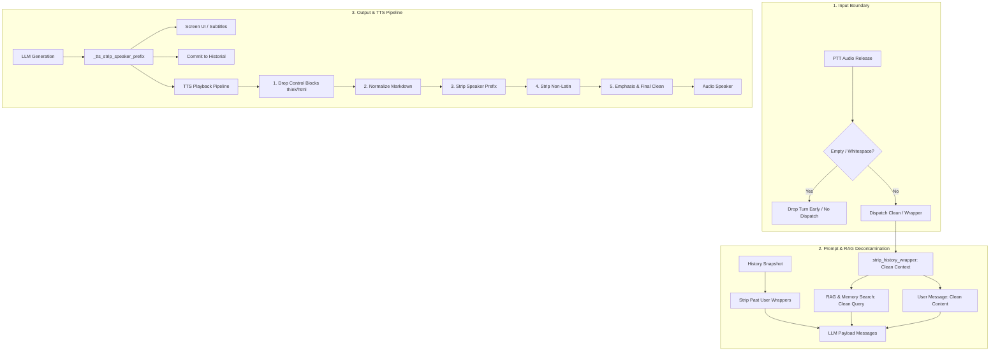

# ADR-058: Clean Transport Turn Provenance, Decontaminate RAG/History, and Harden Speaker-Prefix Sanitization

**Date**: 2026-09-16  
**Status**: Accepted / Implemented  
**Scope**: `opencohost/api/ptt_session.py`, `opencohost/core/context/prompt_assembler.py`, `opencohost/core/llm_engine.py`, `opencohost/core/memory/memoria_store.py`, `opencohost/core/speech/tts_sanitizer.py`, `opencohost/core/turn_scheduler.py`, and regression test suites

---

## Decision Summary

OpenCohost now strictly isolates transport provenance metadata (`"El streamer acaba de decir (PTT): "`, `"El streamer dijo (PTT): "`) from the LLM generation prompt, conversational history projections, and memory RAG query embeddings. Empty audio transcripts are dropped at the Push-to-Talk (PTT) dispatch boundary. 

Additionally, model-generated speaker prefixes (`"Kira:"`, `"Assistant:"`, `"**Kira:**"`, bracketed tags, and thinking-block trailing prefixes) are stripped in a dual-stage architecture: first at generation finalization (before committing to history or emitting to UI/screen logs), and second in the speech synthesis pipeline with an execution order that prevents Markdown or control-tag reconstruction bypasses.

---

## Context and Root Causes

When testing conversational profiles such as `AIKira` with minimal or zero system prompt rules, the LLM exhibited anomalous behavior: speaking in the third person (*"El streamer dijo..."*, *"El streamer expresa..."*), repeating transport framing, and hallucinating dialogue roles.

Investigation revealed five interconnected architectural deficiencies:

1. **Transport Boilerplate in Active Generation Context**:
   The PTT subsystem wrapped incoming transcripts in boilerplate (`i18n_active.ptt_wrapper().format(text=text)`). When delivered to the LLM turn, the model perceived this provenance wrapper as part of the user's explicit utterance.

2. **RAG Vector and Lexical Query Pollution**:
   Both episodic memory retrieval (`mem.recall_decision`) and v4 memory injection (`memorias_builder`) received raw `contexto` containing the wrapper. Search queries were anchored on high-frequency boilerplate tokens (`"streamer"`, `"PTT"`, `"decir"`), skewing semantic similarity scores and degrading memory recall quality.

3. **History Asymmetry & Few-Shot Repetition Drift**:
   While the active turn was partially stripped, prior user turns stored in `self.historial` retained `"El streamer dijo (PTT): ..."`. When projected into the LLM context, these historical turns served as few-shot in-context demonstrations, prompting the model to emulate script-like dialogue formatting.

4. **Empty Transcript Dispatch (Noise Injection)**:
   Releasing the PTT key without speech (or with background noise pruned to whitespace) still dispatched a command containing only the wrapper (`"El streamer acaba de decir (PTT): "`). Stripping this produced an empty string `""`, triggering HTTP 400 Bad Request errors on Cloud APIs (OpenAI, Anthropic) or confused single-token completions on local models.

5. **TTS and Screen Speaker-Prefix Leakage**:
   Local models frequently complete dialogue with character labels (`"Kira:"`, `"[Kira]:"`, `"**Kira:**"`). The previous TTS cleaner ran *before* control-block removal (`<think>`) and *before* Markdown bold normalization, leaving prefixes unstripped whenever preceded by `<think>` blocks or asterisks. Furthermore, the UI screen and history were updated with dirty text before TTS sanitization ran, causing screen/audio divergence.

---

## Architectural Decisions



### D1: Drop Empty Transcripts at Dispatch Boundary (`opencohost/api/ptt_session.py`)

In `PttController._dispatch(self, text: str)`, an immediate guard validates transcript substance:
```python
if not text or not text.strip():
    logger.debug("PTT dispatch dropped: empty transcript")
    return
```
If nothing was spoken, no message is enqueued, no priority queue slot is consumed, and no inference is scheduled. In `PromptContextAssembler.assemble`, a safe fallback (`clean_contexto = "..."`) protects against rare upstream payloads containing only whitespace or stripped wrappers.

### D2: Decontaminate Memory RAG Search Queries (`opencohost/core/llm_engine.py`, `opencohost/core/context/prompt_assembler.py`)

`clean_contexto` is computed upfront before any retrieval calls:
```python
clean_contexto = strip_history_wrapper(contexto)
```
- Passed to `mem.recall_decision(clean_contexto, profile_id=...)` (v5 episodic recall).
- Passed to `memorias_builder(profile_id, clean_contexto)` (v4 memory RAG).
- Passed to `editorial_provider(clean_contexto)`.

Retrieval embeddings and keyword matchers now index only semantic user words.

### D3: Sanitize Historical Conversation Projections (`opencohost/core/context/prompt_assembler.py`)

When assembling `history_snapshot` into the LLM `messages` array, past user messages are dynamically cleaned:
```python
content = msg.get("content", "")
if msg.get("role") == "user" and isinstance(content, str):
    content = strip_history_wrapper(content)
messages.append({"role": msg["role"], "content": content})
```
This ensures zero few-shot leakage of transport wrappers into the model context, even across sessions with legacy history.

### D4: Decontaminate Bundled Owner Questions (`opencohost/core/turn_scheduler.py`)

`compose_owner_bundle` renders queued items into a unified turn. Previously, each question retained its raw wrapper. Now, each member is cleaned individually:
```python
numbered = "\n".join(f"{i}. {strip_history_wrapper(it[2])}" for i, it in enumerate(ordered, 1))
```
The resulting prompt header contains clean, numbered questions without boilerplate repetition.

### D5: Locale-Agnostic Static & Dynamic Wrapper Stripping (`opencohost/core/memory/memoria_store.py`)

`strip_history_wrapper` was upgraded from inspecting only the currently active locale to checking a comprehensive set of cross-locale static prefixes (Spanish and English) plus active i18n accessors, case-insensitively, with tolerance for leading whitespace:
```python
_STATIC_HISTORY_PREFIXES = (
    "El streamer acaba de decir (PTT):",
    "The streamer just said (PTT):",
    "El streamer dijo (PTT):",
    "The streamer said (PTT):",
    "El streamer escribió:",
    "The streamer typed:",
    "LiveVoice:",
    "(PTT):",
    "(PTT)",
)
```

### D6: Dual-Stage Hardened Speaker-Prefix Sanitization (`opencohost/core/speech/tts_sanitizer.py`, `opencohost/core/llm_engine.py`)

1. **Generation Finalization (Stage 1)**:
   In `MotorVocalIA._finalize_generation`, `_tts_strip_speaker_prefix(dialogo)` runs immediately upon receiving LLM output. This prevents `Kira:` or `Assistant:` from reaching `log_queue` (screen logs/UI) and `self._commit_history`.

2. **TTS Playback Pipeline Order (Stage 2)**:
   In `_sanitize_tts_text_for_playback`, operations are reordered to prevent bypasses:
   - Step 1: Drop control blocks (`<think>`, `<analysis>`, HTML tags).
   - Step 2: Normalize Markdown (converts headers, bullets, tables).
   - Step 3: Strip speaker prefixes (now at true start of text).
   - Step 4: Strip non-Latin characters.
   - Step 5: Normalize emphasis (`**bold**` / `*italic*`) and re-strip residual speaker prefixes.

3. **Regex Hardening**:
   Bare persona names (`Kira`, `Akira`) strictly require a colon (`:` or `：`), while roles (`Assistant`, `Co-host`, `Bot`) accept hyphens. This avoids false positives on appositive clauses like *"Kira — ese es mi nombre"*.

---

## Adversarial QA Matrix & Disposition

During review, two independent adversarial judges (`Judge A` and `Judge B`) attacked the implementation. All findings were resolved and verified:

| Code | Vulnerability / Edge Case | Cause | Resolution | Status |
|---|---|---|---|---|
| **P1** | Owner bundle repeats wrappers on every numbered line | `compose_owner_bundle` concatenated raw `it[2]` | Applied `strip_history_wrapper(it[2])` per line | **Resolved** |
| **P2** | RAG search vectors polluted by boilerplate tokens | Raw `contexto` passed to `mem.recall_decision` | Pass `clean_contexto` to retrieval & memory builders | **Resolved** |
| **P3** | Few-shot drift from past historical user turns | Historical turns projected without stripping | Sanitized `user` turns in `history_snapshot` projection | **Resolved** |
| **P4** | Empty PTT speech triggers 400 Bad Request | Empty transcripts dispatched with wrapper | Early return in `_dispatch` if `text.strip() == ""` | **Resolved** |
| **P5** | Cross-locale failure on language switch | Wrapper stripper checked only active locale | Added bilingual static prefix set + leading whitespace strip | **Resolved** |
| **T1** | `<think>` block hides following speaker prefix | Cleaner ran before `<think>` tags dropped | Reordered pipeline: control blocks dropped first | **Resolved** |
| **T2** | `**Kira:**` bold markdown bypasses prefix regex | Markdown emphasis resolved after prefix check | Reordered pipeline & added asterisk matching in regex | **Resolved** |
| **T3** | Leading whitespace bypasses prefix regex | Regex lacked `^\s*` anchor | Added leading whitespace tolerance to regex | **Resolved** |
| **T4** | Screen/history desync with spoken audio | Sanitizer ran inside TTS speaker only | Stripped prefixes at `_finalize_generation` boundary | **Resolved** |
| **T5** | False positive on appositive em-dash | Regex matched `Kira —` with hyphens | Require colon `:`/`：` for bare names; hyphens for roles only | **Resolved** |
| **T6** | CJK full-width colon bypass | Regex checked only ASCII `:` | Supported both `:` and `：` in pattern | **Resolved** |

---

## Alternatives and Tradeoffs

| Alternative Considered | Evaluation & Tradeoff |
|---|---|
| **Prompt Engineering (System Rules)** | *Rejected*. Adding rules like *"Never say 'El streamer dijo'"* inflates system prompts, consumes KV-cache budget, fails when users customize/strip profile prompts, and is unreliable on 7B/8B local models. Architectural decontamination guarantees clean inputs regardless of profile rules. |
| **Database Migration of Historical Rows** | *Rejected*. Rewriting SQLite/JSON history on disk risks data corruption, invalidates existing content hashes, and breaks backwards compatibility. Sanitizing at the prompt assembly boundary is pure, non-destructive, and eliminates few-shot drift instantly. |
| **TTS-Only Speaker Prefix Stripping** | *Rejected*. Stripping prefixes only in TTS audio leaves the UI subtitles and persistent history dirty (*"Kira: Kira: ..."*), causing desynchronization between what the user reads on screen and what they hear. Dual-stage sanitization keeps screen, history, and voice perfectly aligned. |

---

## Verification Evidence

All 275 regression and unit tests across the affected subsystems pass with zero errors:

```powershell
.venv\Scripts\python.exe -m pytest tests/test_prompt_context_assembler.py tests/test_tts_markdown_normalizer.py tests/test_owner_question_bundling.py tests/test_ptt_session.py tests/test_memoria_recall_routing.py
```

```
======================= 275 passed in 106.55s (0:01:46) =======================
```

### Specific Regression Pins Added:
- `test_dispatch_drops_empty_and_whitespace_transcript` in [`tests/test_ptt_session.py`](file:///E:/VoiceAI/tests/test_ptt_session.py)
- `test_assemble_strips_history_wrappers_from_past_user_turns` in [`tests/test_prompt_context_assembler.py`](file:///E:/VoiceAI/tests/test_prompt_context_assembler.py)
- `test_assemble_passes_clean_context_to_memorias_builder` in [`tests/test_prompt_context_assembler.py`](file:///E:/VoiceAI/tests/test_prompt_context_assembler.py)
- `test_strip_history_wrapper_cross_locale_and_whitespace` in [`tests/test_prompt_context_assembler.py`](file:///E:/VoiceAI/tests/test_prompt_context_assembler.py)
- Expanded `test_speaker_prefix_stripping_on_playback` in [`tests/test_tts_markdown_normalizer.py`](file:///E:/VoiceAI/tests/test_tts_markdown_normalizer.py) testing `<think>` blocks, Markdown bold, parenthetical em-dashes, and bracketed roles.
