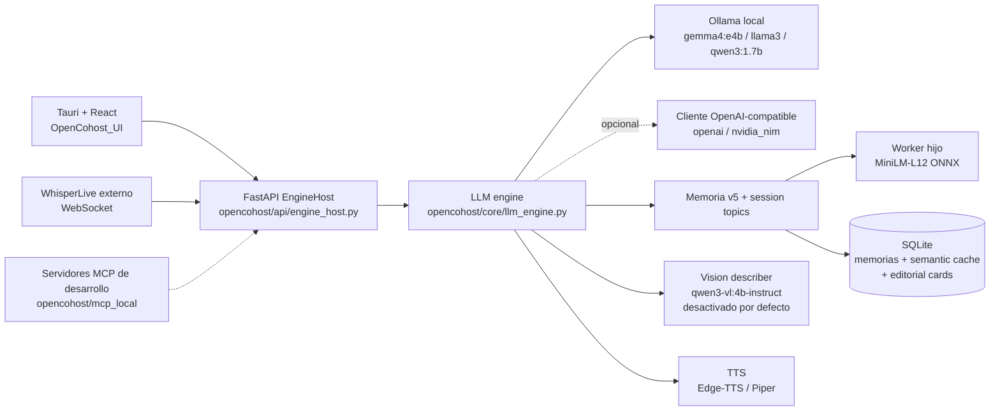
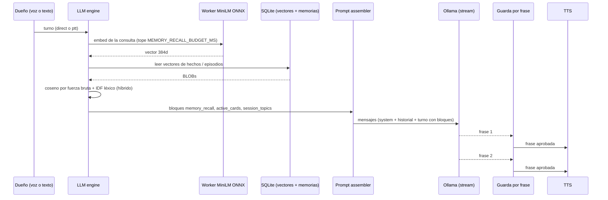
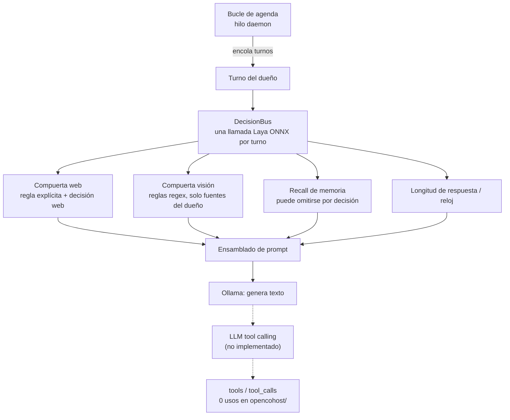
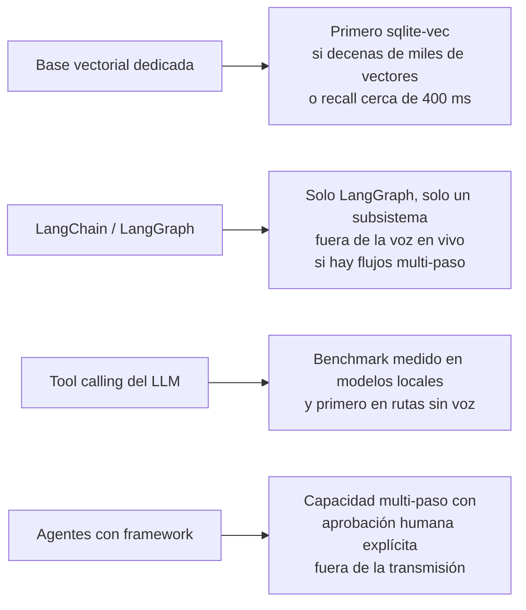

# ADR-066: Inventario del stack de IA y decisiones de no adopción (base de datos vectorial, LangChain/LangGraph, tool calling, agentes con framework)

**Fecha**: 2026-10-18
**Estado**: Aceptado 2026-10-18 (el dueño solicitó este registro y decidió la Decisión 1)
**Alcance**: registro verificado del stack de IA, una decisión de configuración (session topics ON por defecto) y cuatro decisiones de no adopción con criterios de revisión.
**Relacionado**: ADR-024 (editorial cards como RAG primitivo), ADR-034 (memoria léxica), ADR-053 (benchmark semántico diferido), ADR-059 y ADR-060 (recall episódico y ranking semántico), ADR-064 (prefijo estable para KV cache), ADR-065 (memoria de reflexión del dueño), `odd/tasks/session-topic-folder-20261016.md`

---

## Contexto

No existía un registro único y verificado de qué usa realmente el sistema en materia de IA. El dueño preguntó qué hay de verdad detrás de las etiquetas de moda (GenAI, RAG, agentes) y qué se descartó a propósito. La respuesta estaba repartida entre ADR de memoria, diseños de tracks y comentarios en `settings.py`, y en un caso (tool calling) existe un diseño documentado que nunca se implementó.

Este ADR hace tres cosas:

1. Fija un **inventario verificado** del stack, cada afirmación con `ruta:línea` reabierta el 2026-10-18.
2. Registra una decisión de configuración tomada hoy por el dueño (Decisión 1).
3. Documenta **por qué no** se adoptaron una base de datos vectorial, LangChain/LangGraph, tool calling del LLM y agentes autónomos con framework, y bajo qué condiciones se revisaría cada una.

Convención de este documento: **Justificación documentada** significa que el razonamiento ya existe en un documento del repositorio y se cita. **Análisis (no documentado previamente)** significa razonamiento nuevo, fundamentado en hechos del repositorio, pero que nadie había escrito antes. Los puntos que no pude confirmar se marcan como "no verificado".

---

## Inventario verificado

### Diagrama D1: vista general del sistema



### LLM y modelos

| Hecho | Evidencia |
|---|---|
| El único cliente LLM local es el SDK Python `ollama` (dependencia core). | `pyproject.toml:25`; `opencohost/core/engine/llm_inference_service.py:22`; `opencohost/core/engine/llm_engine_models.py:1330` |
| Hay HTTP crudo a `/api/chat` en dos módulos: la reflexión del dueño (cliente `httpx`) y el describer de visión. | `opencohost/core/engine/llm_engine_reflection.py:54`; `opencohost/core/vision/describer.py:368` |
| Modelo por defecto `gemma4:e4b`; tiers quality/balanced/fast = `gemma4:e4b` / `llama3` / `qwen3:1.7b`. | `opencohost/config/settings.py:85`, `:113-117` |
| Cliente cloud opcional, compatible con la API de OpenAI, sin SDK de proveedor (usa `requests` y la ruta `/chat/completions`). Presets `openai` y `nvidia_nim`. | `opencohost/core/providers/cloud/cloud_llm_client.py:20`, `:30`; `opencohost/config/settings.py:132-141` |
| Proveedor activo por defecto: `local`. | `opencohost/config/llm_provider.py:27` |
| Layout de prompt por defecto `legacy`. El layout v2 (ADR-064) ya pasó T7 en turnos del dueño el 2026-10-16 (reuso mediano 83.8 % frente a ~31 %; `STREAM_TTFA` mediano 1809 ms frente a 2420 ms). Falta el cambio de default (paso 6 del rollout de ADR-064), T8 y medir turnos de chat. | `opencohost/config/settings.py:1135`; `odd/tasks/kv-cache-prompt-layout-20261015.md:201-211` |
| Streaming por frase, activo por defecto; se desactiva con `OPENCOHOST_LLM_STREAMING=0` más reinicio. | `opencohost/config/settings.py:1069` |
| Watchdog y rollback ante inferencia estancada. | `opencohost/core/engine/llm_engine_models.py:764` (`_recover_from_stalled_inference`), `:843` (`_rollback_to_last_known_good_model`) |
| Visión: modelo `qwen3-vl:4b-instruct`, `VISION_ENABLED` desactivado por defecto. | `opencohost/config/settings.py:808`, `:810` |
| TTS: Edge-TTS (dependencia opcional) y Piper. | `opencohost/core/llm_engine.py:20-22`; `opencohost/core/speech/backends/tts_piper.py:14` |
| STT: servidor WhisperLive externo consumido por WebSocket; no hay Whisper local. | `opencohost/api/ptt_session.py:3-4`, `:35`. Búsqueda de imports `faster_whisper`/`whisper` en `opencohost/`: sin resultados. |

### Embeddings y almacenamiento vectorial

| Hecho | Evidencia |
|---|---|
| Embeddings con `sentence-transformers/paraphrase-multilingual-MiniLM-L12-v2` exportado a ONNX (384 dimensiones), ejecutado con `onnxruntime` y `tokenizers`, dentro de un proceso hijo aislado. El paquete `sentence-transformers` no se usa. | `modelos_f5/minilm_l12_onnx/config.json:2`, `:13`; `opencohost/core/memory_v5_shadow/semantic.py:109-115`, `:135`, `:151`; `opencohost/core/memory_v5_shadow/semantic_worker.py:4`, `:44-46` |
| Los vectores viven en SQLite como BLOB: tablas `exchange_embeddings`, `episode_embeddings`, `fact_embeddings`. | `opencohost/core/memory_v5_shadow/semantic_cache.py:92-132` |
| Las editorial cards guardan su embedding en la columna `editorial_cards.embedding`. | `opencohost/core/editorial/editorial_cards.py:266`, `:630-644` |
| No hay índice ANN. El ranking de hechos es un producto punto de fuerza bruta con NumPy. | `opencohost/core/memory_v5_shadow/fact_index.py:204-208` |
| El ranking de cards usa coseno en Python puro, también de fuerza bruta. | `opencohost/core/editorial/active_card_retrieval.py:35-44` |
| Los fences de privacidad (`profile_privacy_fences`, `global_privacy_fence`) están en la misma base SQLite que los vectores. | `opencohost/core/memory_v5_shadow/semantic_cache.py:135-143`, `:194`, `:433` |

### RAG y contexto

| Hecho | Evidencia |
|---|---|
| RAG híbrido: coseno semántico más corroboración léxica (IDF), con ranking estable. | `opencohost/core/memory/memoria_store.py:603` (`_compute_candidate_idf`), `:624` (`_lexical_scores`), `:662` (`select_top_k_hybrid`); ADR-060 |
| `MEMORY_V5_MODE` por defecto `ACTIVE`. `MEMORY_FACTS_ENABLED` y `MEMORY_SEMANTIC_ENABLED` son `True`. | `opencohost/config/settings.py:646`, `:718`, `:729` |
| Presupuesto de recall `MEMORY_RECALL_BUDGET_MS` = 400 ms por defecto (un recall que lo excede se descarta y cae a léxico). | `opencohost/config/settings.py:674-690` |
| Los grupos de inyección `active_cards`, `memory_recall` y `session_topics` se arman en el ensamblador de prompt. | `opencohost/core/context/prompt_assembler.py:737`, `:901`, `:904-909`, `:925-926` |
| Session topics: umbrales de coseno MiniLM 0.55 (asignar) y 0.60 (recuperar). | `opencohost/config/settings.py:1164-1165`; `opencohost/core/context/session_topics.py:13-14`, `:101-102` |
| Capacidad por perfil de memorias: `MEMORIAS_PROFILE_CAP` = 200. | `opencohost/config/settings.py:555` |

### Comportamiento agéntico (artesanal y determinista)

| Componente | Evidencia |
|---|---|
| `DecisionBus`: una llamada al clasificador Laya (ONNX) por turno; cada consumidor resuelve con la regla como respaldo. | `opencohost/core/decision/bus.py:1-18`, `:175`; `opencohost/core/decision/laya_worker.py:1`; `opencohost/core/decision/laya_onnx.py:397` |
| Modos por decisión `off`, `shadow`, `on`. | `opencohost/config/settings.py:867`; `opencohost/config/decisions.py:4` |
| Compuerta de búsqueda web: regla explícita más decisión Laya, con presupuesto de espera. | `opencohost/core/engine/llm_engine_web.py:1-30` |
| Compuerta de visión: reglas con regex, solo para fuentes del dueño (`direct`, `ptt`). | `opencohost/core/vision/gate.py:1-8`, `:17` |
| Bucle de agenda autónomo en un hilo daemon, bajo `agenda_lock`. | `opencohost/api/agenda_driver.py:1-18` |
| Router de habla determinista con pila LIFO de trabajos suspendidos. | `opencohost/core/speech/router.py:10`, `:159` |
| Agregador de intenciones basado en regex. | `opencohost/smart_aggregator/intent_aggregator.py:1`, `:89` |

### Roles multi-modelo y guardas de salida

- Generador de respuestas (modelo del tier activo), juez de memoria, reflexión del dueño (ADR-065) y describer de visión.
- El juez de memoria usa salida restringida: `format=<esquema JSON>` con `temperature: 0`. Evidencia: `opencohost/core/engine/llm_engine_scout.py:553-558`, `:575-583`.
- Las guardas de salida son reglas, no un LLM crítico: `output_guard` en `opencohost/config/validation.py:679` (cabecera del módulo en `:7`).

### Ausencias verificadas

**Sin tool calling del LLM.** Búsqueda ejecutada el 2026-10-18:

```text
grep -rnE "tool_calls|function_call|tool_choice|[\"']tools[\"']" opencohost --include=*.py
grep -rnE "tools\s*=" opencohost --include=*.py
```

Resultados: `opencohost/config/storage.py:100` y `:117` (lectura de una clave de configuración llamada `tools`, ajena a Ollama) y `opencohost/core/speech/tts_sanitizer.py:31-32` (expresión regular que elimina etiquetas `<tool_call>` del texto antes de TTS). Ninguna llamada a Ollama ni al cliente cloud envía `tools`.

Existe un diseño de tool calling documentado pero **no implementado**: `conductor/tracks/memory_recall_tools_20260725/design.md`. La búsqueda de `memory_search`, `learned_tool_support` y `_MEMORY_TOOL_MAX_ROUNDS` en `opencohost/` no devuelve nada, y el track no figura en `conductor/tracks.md`.

**Sin frameworks de IA ni bases vectoriales.**

- Imports: `grep -rnE "^\s*(import|from)\s+(langchain|langgraph|llama_index|crewai|autogen|chromadb|faiss|qdrant_client|sentence_transformers|openai|anthropic)" opencohost tests --include=*.py` devuelve cero resultados.
- `pyproject.toml:21-37` (dependencias core) y `:39-82` (extras) no declaran ninguno.
- Entorno vivo `E:\Miniconda\envs\opencohost`: `pip list` (solo lectura) no lista langchain, langgraph, llama-index, crewai, autogen, chromadb, faiss, qdrant-client, sentence-transformers, openai ni anthropic. Sí lista `ollama 0.6.2`, `onnxruntime 1.30.0`, `tokenizers 0.23.2`, `numpy 2.4.6` y `mcp 1.30.0`.

**MCP solo para desarrollo.** Servidores FastMCP en `opencohost/mcp_local/` (`server.py:25`, `diagnostics.py`, `config.py`), registrados en `.mcp.json`. `mcp` es un extra opcional que la app nunca importa (`pyproject.toml:74-77`).

### Diagrama D2: un turno del dueño con RAG



Si el embed excede el presupuesto, el recall se descarta y el turno usa solo recuperación léxica (`settings.py:674-690`, comentario sobre `fallback=timeout`).

---

## Decisión 1: Session topics ON por defecto

**Decisión del dueño, 2026-10-18.** `OPENCOHOST_SESSION_TOPICS` ahora es ON por defecto. Se desactiva con `off`, `0`, `false` o `no`, más reinicio. Código: `opencohost/config/settings.py:1157-1161` (comentario de la decisión en `:1146-1151`).

**Justificación documentada.** Una función que nace apagada no se ejecuta y por lo tanto no produce evidencia. Es el mismo razonamiento que el repositorio aplicó a `LLM_STREAMING_ENABLED` (CLAUDE.md, sección del checkpoint `llm_output_streaming_20260813`; resolución en `opencohost/config/settings.py:1038-1069`).

**Efecto sobre el prefijo estable (ADR-064).** El bloque `<session_topics>` nunca entra en el mensaje `system`: `prompt_assembler.py:902-903` lo declara volátil y solo para fuentes del dueño, y en el layout v2 se coloca en el preámbulo por turno (`prompt_assembler.py:926`), después del prefijo estable. Por eso el prefijo sigue idéntico byte a byte.

**Consecuencia para las mediciones de KV cache.** T7 se midió el 2026-10-16 con session topics apagado. A partir de ahora, las mediciones posteriores (por ejemplo, la de turnos de chat que sigue pendiente) incluirán ese bloque volátil cuando se recupere un tema. Su tamaño está acotado a 2 líneas y 240 caracteres (`settings.py:1172-1173`). El comentario original de `settings.py` indicaba que el motivo del OFF inicial era no perturbar T7; las mediciones nuevas deben anotar que la condición cambió.

**Precondiciones que siguen vigentes.** Requiere `MEMORY_SEMANTIC_ENABLED` y `MEMORY_FACTS_ENABLED` (ambos `True` por defecto, `settings.py:729`, `:718`) y un perfil "caliente" con embeddings de hechos; un perfil frío nunca recupera un tema y la captura no gasta embeds (`settings.py:1152-1155`).

---

## Decisión 2: No hay base de datos vectorial

Se mantiene SQLite como único almacén, con BLOBs y coseno de fuerza bruta (ver inventario).

### Justificación documentada

- `conductor/tracks/memoria_retrieval_upgrade_ladder/proposal.md:126-128`: con 200 a 1000 vectores, un coseno de fuerza bruta cuesta microsegundos; "No vector index (no sqlite-vec, no FAISS) at this scale". Rechaza ambas opciones de forma explícita.
- `docs/adr/ADR-034-memoria-retrieval-stays-lexical.md:186-192`: pasar a FTS5/BM25 solo si el tope de perfil sube a miles, y embeddings por fuerza bruta sin índice "at this scale", condicionados a VRAM libre.
- `docs/adr/ADR-024-editorial-cards-primitive-rag.md:84`: las cards se recorren con un escaneo lineal, sin índice; el ADR nombra FAISS/pgvector/HNSW como lo que hace un RAG moderno y lo posterga conscientemente.
- `docs/adr/ADR-053-deferred-memory-v5-semantic-benchmark-architecture.md:199`: el ADR no aprueba dependencias, descargas de modelos ni bases vectoriales.
- Direcciones planeadas y **no implementadas**: Qdrant local como sidecar (`docs/adr/ADR-049-provider-readiness-reconciliation-and-ptt-speech-safety.md:120`, `conductor/tracks/memoria_promotion_foreground_safety_20260823/plan.md:169`), FTS5/BM25 (ADR-034 arriba) y `nomic-embed-text` por Ollama (`proposal.md:121-125`).

### Análisis (no documentado previamente)

- **Escala por perfil.** El almacén es por perfil y el tope de memorias es 200 (`settings.py:555`). Un escaneo lineal sobre esa cantidad de vectores de 384 dimensiones no justifica un índice.
- **Un solo almacén con los fences de privacidad adentro.** Los fences (`profile_privacy_fences`, `global_privacy_fence`) viven en la misma base SQLite que los vectores (`semantic_cache.py:135-143`). Una base vectorial externa obligaría a mantener sincronizados el borrado por perfil y el "olvidar todo" en dos sistemas.
- **Sin demonio extra en la máquina del streamer.** El producto es local-first y el empaquetado está diferido; un servicio adicional (Qdrant, Chroma) agrega proceso, puerto y ciclo de vida al arranque que hoy gestiona el backend de Tauri.

### Criterios de revisión

Los umbrales son propuestas, **no se midieron**:

1. Si los vectores por perfil crecen a decenas de miles, o si el escaneo de fuerza bruta amenaza `MEMORY_RECALL_BUDGET_MS` (400 ms, `settings.py:690`), evaluar primero `sqlite-vec`, que se queda dentro de SQLite.
2. Una base vectorial dedicada (Qdrant u otra) solo si `sqlite-vec` tampoco alcanza o si aparece un caso de uso de búsqueda entre perfiles.
3. Antes de cualquier cambio, medir la latencia de recall en una sesión real (hay una réplica offline de 286 consultas en el comentario de `settings.py:674-680`), no estimarla.

---

## Decisión 3: No se adoptan LangChain ni LangGraph

**Búsqueda de justificación previa.** Se buscó `langchain`, `langgraph`, `llamaindex`, `crewai` y `autogen` en `docs/`, `conductor/`, `README.md` y `AGENT_HANDOFF.md`. No hay ningún documento que registre una decisión de no adoptarlos. El razonamiento siguiente es, por tanto, **Análisis (no documentado previamente)**.

### Análisis

- **La ruta caliente es un turno de voz en vivo con control exacto del prompt.** ADR-064 depende de que el mensaje `system` se mantenga idéntico byte a byte para reutilizar KV cache. Un framework que posee las plantillas de prompt y el ensamblado de mensajes compite con ese control.
- **Streaming por frase con guarda por frase.** El diseño `conductor/tracks/llm_output_streaming_20260813/design.md:41` fija la política "Head hot, body guarded": se habla la primera frase y cada frase pasa por la guarda antes de salir. Eso exige poseer el bucle de lectura del stream; las abstracciones de cadenas de un framework lo ocultan.
- **Watchdog y rollback que deben liberar el runner único de Ollama.** El track `heavy_model_inference_recovery_20260609` falló dos veces el 2026-08-13 porque la petición abandonada mantenía ocupado el único runner, y se corrigió en `a8830bb` (CLAUDE.md:87). Cerrar el socket desde cualquier hilo es un requisito (`opencohost/core/engine/llm_engine_reflection.py:40`). Un framework que posee el ciclo de vida de la petición dificulta esa garantía.
- **Un solo proveedor local más un cliente OpenAI-compatible.** La abstracción de proveedores aporta poco: el cliente cloud ya es un módulo corto sobre `requests` (`cloud_llm_client.py:20`, `:30`).
- **Peso y rotación de dependencias frente al empaquetado diferido.** Un framework añade un árbol grande de dependencias y cambios de API frecuentes a un producto cuyo empaquetado sigue diferido (CLAUDE.md, "Deferred").
- **Los flujos ya son deterministas y están modelados.** El `DecisionBus` ya expresa off/shadow/on con respaldo por regla (`bus.py:1-18`); un grafo de estados no agregaría capacidad en la ruta de voz.

### Criterios de revisión

Si aparecen flujos de varios pasos con herramientas y estado ramificado, evaluar LangGraph **solo para ese subsistema** y fuera de la ruta de voz en vivo. No se propone ningún umbral numérico.

---

## Decisión 4: No hay tool calling del LLM

### Justificación documentada

`conductor/tracks/memory_recall_tools_20260725/design.md:23-40` ya evaluó una herramienta `memory_search` y concluyó que una ronda de herramienta es "a full second inference added to time-to-first-word" y que en local "is a broken co-host" (`:34`); por eso se acotó a solo cloud y se rechazó en local. **Esa premisa está desactualizada en un punto**: el documento afirma "There is no streaming anywhere" (`:25`), pero el streaming por frase hoy está activo por defecto (`settings.py:1069`). La conclusión sobre la latencia sigue siendo coherente con el diseño actual, pero hay que revalidarla con el streaming, no darla por cerrada. El diseño nunca se implementó (ver "Ausencias verificadas").

### Análisis (no documentado previamente)

- **Cada ronda de herramienta es una llamada completa extra dentro de un turno de voz.** Los presupuestos de espera del repositorio muestran cuánto cuesta equivocarse: `STREAM_IDLE_TIMEOUT_SECONDS = 40` (`settings.py:1224`), tope de 45 s tras un cambio de modelo (comentario en `settings.py:1220-1222`) y `MEMORY_RECALL_BUDGET_MS = 400` (`settings.py:690`) para todo el recall. Una ronda adicional compite con el primero de esos presupuestos y excede por mucho el último.
- **El streaming por frase choca con esperar una decisión de herramienta.** La primera frase solo puede salir cuando el modelo decide si responde o llama una herramienta.
- **Modelos locales pequeños.** Con tiers como `gemma4:e4b` y `qwen3:1.7b` (`settings.py:113-117`), la selección de herramientas puede ser menos fiable. Esto es un **riesgo general, no un hecho medido en este repositorio**.
- **Las compuertas deterministas son testeables, auditables y dan interruptores al dueño.** Web (`llm_engine_web.py`), visión (`vision/gate.py`) y modos por decisión (`settings.py:867`) se prueban sin un modelo y se apagan con una variable de entorno.
- **Laya responde preguntas de decisión dentro del proceso sin gastar el LLM** (`bus.py:1-18`).
- **El patrón de salida estructurada que el repositorio ya prefiere** es `format=<esquema JSON>` a temperatura 0 (`llm_engine_scout.py:553-558`, `:575-583`), no el protocolo de herramientas.

### Criterios de revisión

1. Un benchmark medido de precisión de tool calls sobre los modelos locales objetivo.
2. Empezar solo en rutas que no sean de voz en vivo (por ejemplo, el juez de memoria o tareas de fondo).
3. Si se retoma el diseño de `memory_recall_tools_20260725`, rehacer su análisis de latencia contra el streaming actual.

---

## Decisión 5: No hay agentes autónomos abiertos con framework

El proyecto **sí** tiene agencia acotada: bucle de agenda (`api/agenda_driver.py`), `DecisionBus`, compuertas de web y visión. Lo que no se adopta es un agente abierto que planifica y elige herramientas por su cuenta, ni un framework que lo orqueste.

### Justificación documentada

- **Producto supervisado.** CLAUDE.md:18 define el objetivo como "a supervised AI co-host without cloud subscriptions". `conductor/product.md` no usa el término "supervisado"; sí fija como principios la degradación elegante y el control local (sección Design Principles) y como no-objetivos "No es un SaaS cloud" y "No requiere suscripción" (sección Non-Goals, `product.md:30-33`).
- **Radio de impacto en una transmisión en vivo.** Evidencia del 2026-08-13 (CLAUDE.md:138-139, `logs/opencohost_20260813_154829.log` 16:10:13): la guarda `no_ai_self_identification` (R9) bloqueó una respuesta real con `source=direct`. Bajo la política "head hot" del streaming esa línea se habría emitido unos 2.6 s antes de que llegara el veredicto, por lo que la guarda por frase es obligatoria. Un agente que actúa sin supervisión multiplica ese riesgo.

### Análisis (no documentado previamente)

- Un agente abierto hace que el conjunto de acciones sea impredecible, y el contrato del producto exige que cada acción tenga un interruptor del dueño y una guarda verificable. Las compuertas actuales tienen ambos.
- Un framework de agentes añadiría las objeciones de la Decisión 3 (control del ciclo de vida) a las de la Decisión 4 (latencia y fiabilidad de herramientas).

### Criterios de revisión

Reconsiderar solo si el dueño define una capacidad que requiera planificación de varios pasos, con acciones reversibles, fuera de la transmisión en vivo y con aprobación humana explícita antes de ejecutar.

### Diagrama D3: flujo de decisión agéntico artesanal



---

## Deuda y señales detectadas

| # | Señal | Estado | Evidencia |
|---|---|---|---|
| 1 | `numpy` se importa en `core/memory_v5_shadow/*` y `core/decision/laya_onnx.py` pero no está declarado en `pyproject.toml`. | Verificado | Imports: `opencohost/core/decision/laya_onnx.py:39`, `core/memory_v5_shadow/episodic_recall.py:20`, `fact_index.py:31`, `retrieval.py:15`, `semantic.py:8`, `semantic_cache.py:17`. Dependencias: `pyproject.toml:21-37` sin `numpy`. En el entorno vivo está instalado (2.4.6), probablemente de forma transitiva; el árbol de dependencias no se inspeccionó (no verificado). |
| 2 | `onnxruntime` solo está en el extra `local-tts`, aunque memory v5 (ACTIVE por defecto) y Laya lo importan. | Verificado | `pyproject.toml:45-48`; `semantic.py:135`; `laya_onnx.py:397`; `settings.py:646`. Una instalación sin ese extra depende de que la ruta semántica falle abierta a léxico; no probé ese escenario (no verificado). |
| 3 | `.mcp.json` versionado incluye `OPENCOHOST_MCP_DEBUG_PROMPT=1`, mientras que `odd/tasks/mcp-local-20261015.md:56` afirma que no está activado en el `.mcp.json` versionado. | Verificado: contradicción | `.mcp.json:6`; commit `bed86ab` ("enable debug prompt tools"); `odd/tasks/mcp-local-20261015.md:56`. El flag expone trazas de prompt por el servidor MCP de desarrollo; hay que decidir si debe quedar activo en un archivo versionado. |
| 4 | Versión del paquete instalado en el entorno `opencohost` (0.3.0a4) distinta de `__version__` (0.5.0a1). | Verificado | `pip list` del entorno vivo; `opencohost/__init__.py:4`. Es una instalación editable (`E:\VoiceAI`); la metadata está desactualizada. Se resuelve reinstalando en modo editable. |
| 5 | Los recibos del benchmark semántico dicen `terminal_route: KEEP_LEXICAL` y marcan las variantes `b` y `c` como `CRITICAL_REGRESSION` (razón `NO_MEMORY_INJECTION`), pero la recuperación semántica se entregó después por ADR-059/060. | Verificado: tensión sin cerrar | `docs/memory_v5/generations/run-20260831-061713/receipt.json` (`terminal_route`, `quality_status` de `b` y `c`; igual `KEEP_LEXICAL` en `run-20260831-071728`, `-073740` y `-182044`). ADR-060 (2026-09-23) se aprobó por pedido del dueño y reemplaza la regla de ADR-034 (`docs/adr/ADR-060-fact-notebook-semantic-ranking.md:5-7`, `:10-16`). ADR-060 no cita ese recibo. El run `run-20260901-062229` nombra como ganador `H2_LEXICAL_CORROBORATION`; que el híbrido de `select_top_k_hybrid` implemente esa variante no está verificado. |

---

## Consecuencias

### Positivas

- Existe un registro único y verificable de lo que el sistema usa y de lo que descartó, con criterios de revisión explícitos.
- Se evita adoptar infraestructura (vector DB, frameworks) sin evidencia, y se conservan el control del prompt, el streaming por frase y la recuperación de inferencia.
- La Decisión 1 empieza a generar evidencia real de session topics.
- Las señales de deuda quedan visibles y accionables.

### Negativas

- Se mantiene código propio donde un framework daría atajos (ensamblado de prompt, compuertas, recuperación), y su mantenimiento es del proyecto.
- El coseno de fuerza bruta no escala indefinidamente; el criterio de revisión depende de que alguien mida cuándo se acerca el límite.
- Las mediciones de KV cache posteriores a T7 incluirán el bloque `<session_topics>` cuando haya un tema recuperado, lo que las vuelve menos comparables con la línea base y con T7.
- Varias razones de las Decisiones 3, 4 y 5 son análisis, no evidencia medida; pueden requerir corrección cuando haya benchmarks.

---

## Alternativas consideradas

| Alternativa | Estado | Motivo | Se revisa cuando |
|---|---|---|---|
| Base vectorial dedicada (Qdrant, Chroma, FAISS) | Rechazada por ahora | Escala por perfil, un solo almacén con fences de privacidad, sin demonio extra (Decisión 2) | Vectores por perfil en decenas de miles o recall cerca de `MEMORY_RECALL_BUDGET_MS` |
| `sqlite-vec` | No adoptada todavía | Innecesaria a la escala actual; es el primer paso si se necesita un índice | Mismo disparador que arriba |
| FTS5/BM25 | Planeada, no implementada | ADR-034 la reserva para tope de perfil en miles | `MEMORIAS_PROFILE_CAP` subido a miles |
| LangChain | Rechazada | Compite con el control del prompt y del stream (Decisión 3) | No se propone umbral |
| LangGraph | Rechazada para la ruta de voz | Flujos ya deterministas (Decisión 3) | Flujos multi-paso con estado ramificado, fuera de la voz en vivo |
| Tool calling del LLM | Rechazada por ahora | Latencia dentro del turno de voz y fiabilidad de modelos pequeños (Decisión 4) | Benchmark de precisión en los modelos objetivo, empezando por rutas sin voz |
| Agentes autónomos con framework | Rechazada | Producto supervisado y radio de impacto en vivo (Decisión 5) | Capacidad multi-paso con aprobación humana, fuera de la transmisión |
| Session topics OFF por defecto | Reemplazada | Una función apagada no produce evidencia (Decisión 1) | Si una medición de KV cache o de TTFA muestra una regresión atribuible al bloque |

### Diagrama D4: no adopciones y su disparador de revisión



Resumen en tabla (equivalente al diagrama):

| No adopción | Disparador de revisión | Primer paso si se activa |
|---|---|---|
| Base vectorial dedicada | Decenas de miles de vectores por perfil, o recall amenazando `MEMORY_RECALL_BUDGET_MS` (umbral propuesto, no medido) | `sqlite-vec` dentro de SQLite |
| LangChain / LangGraph | Flujos multi-paso con herramientas y estado ramificado | LangGraph en un subsistema, fuera de la voz |
| Tool calling del LLM | Benchmark medido de precisión en los modelos locales objetivo | Rutas sin voz primero |
| Agentes autónomos con framework | Capacidad multi-paso con aprobación humana, fuera de vivo | Prototipo aislado y supervisado |

---

## Referencias

- `docs/adr/ADR-024-editorial-cards-primitive-rag.md`, `docs/adr/ADR-034-memoria-retrieval-stays-lexical.md`, `docs/adr/ADR-049-provider-readiness-reconciliation-and-ptt-speech-safety.md`, `docs/adr/ADR-053-deferred-memory-v5-semantic-benchmark-architecture.md`, `docs/adr/ADR-059-episodic-recall-merge.md`, `docs/adr/ADR-060-fact-notebook-semantic-ranking.md`, `docs/adr/ADR-064-kv-cache-stable-prefix-layout.md`, `docs/adr/ADR-065-owner-reflection-memory.md`
- `conductor/tracks/memoria_retrieval_upgrade_ladder/proposal.md`
- `conductor/tracks/memory_recall_tools_20260725/design.md`
- `conductor/tracks/llm_output_streaming_20260813/design.md`
- `conductor/tracks/memoria_promotion_foreground_safety_20260823/plan.md`
- `docs/memory_v5/generations/run-20260831-061713/receipt.json`
- CLAUDE.md (secciones "Current operating mode" y "Roadmap")
